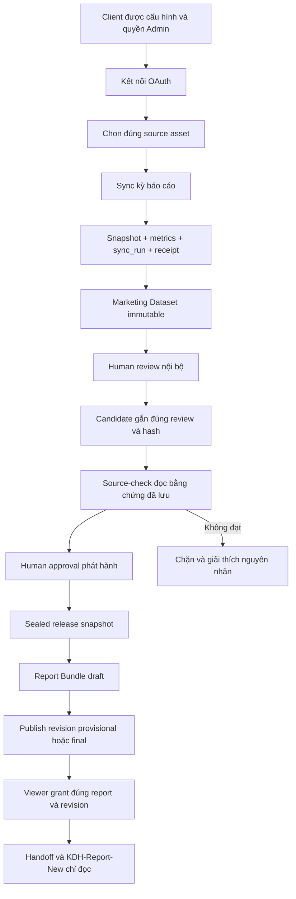

# KDH Admin — Audit UX, điều hướng và luồng Admin → New

Ngày kiểm tra: 19/10/2026. Phạm vi: **read-only audit**, không triển khai.

## 1. Kết luận và cách đọc bằng chứng

Admin có ba luồng đang cùng tồn tại, nhưng menu chưa giúp người dùng phân biệt chúng:

1. **Phân tích → Dataset → Excel/HTML → Báo cáo HTML nội bộ**: luồng cũ, chủ yếu Google/CSV.
2. **Dataset → Report Builder → Bundle draft/preview**: trình cấu hình báo cáo; UI còn ràng buộc KinderHealth và chưa theo kịp contract Meta.
3. **Dữ liệu đã sync → Marketing Dataset → duyệt nội bộ → Candidate → source-check → duyệt phát hành → release snapshot → Bundle → xuất bản → cấp quyền → New**: luồng cần dùng cho Facebook Content hiện tại.

**Report Builder không phải bước bắt buộc của luồng Marketing hiện có.** “Duyệt nội bộ”, “Duyệt phát hành”, “Tạo snapshot phát hành” và “Xuất bản Report Bundle” là các thao tác khác nhau. Có số liệu hoặc có release snapshot chưa có nghĩa là đã có báo cáo khách hàng.

Các phát hiện ưu tiên:

- Sandbox hiện **chưa có Report Bundle**, dù có hai release snapshot.
- `REPORT_NEW_BASE_URL` và `DASHBOARD_URL` đang rỗng; service credential của Bundle chưa được cấu hình. Không thể nghiệm thu Admin → New ở cấu hình này.
- `kdh/viewer_handoff.py` vẫn chỉ nhận `client_kinderhealth`; VIO bị chặn ở handoff ngay cả khi sửa URL và tạo Bundle hợp lệ. Không được giải quyết bằng cách đổi client của dữ liệu VIO.
- Page VIO hiện `enabled=0` sau một lần kết nối Meta mới. Source-check đang chặn đúng theo policy; không phải lỗi thiếu dữ liệu tự động được phép bỏ qua.
- Marketing cho phép bấm duyệt/tạo Candidate nhiều lần sau mỗi request. Trạng thái sau khi mở release snapshot lại báo “Chưa có bản chờ duyệt phát hành”, dễ khiến người dùng quay lại làm lại các bước.
- Nút `Mở báo cáo` có thuộc tính `hidden` nhưng CSS `.btn { display:inline-flex }` có thể làm nó hiện ra dù chưa có `href`. Probe DOM/CSS offline đã tái hiện.

Quy ước bằng chứng:

- **SOURCE**: đã đọc implementation hiện tại, không suy ra từ tên menu.
- **RUNTIME READ-ONLY**: metadata Docker, HTTP health, SELECT trong transaction read-only, hoặc verifier chỉ đọc được gọi trực tiếp trong transaction đó.
- **OFFLINE PROBE**: DOM/CSS local, không gọi app/provider/DB.
- **NOT TESTED**: không thực hiện browser flow có khả năng ghi trạng thái, không gọi provider, không chạy New E2E.

Đã đọc `AGENTS.md`, `docs/SYSTEM_CONTEXT.md`, `KDH_FACEBOOK_REPORTS_HANDOFF.md`. Các nhận định runtime cũ trong tài liệu chỉ được dùng làm lịch sử. Ví dụ ghi chú cũ “chưa có Dataset builder từ persisted data” và “backend chưa hỗ trợ section có underscore” không còn đúng cho backend hiện tại; một số hạn chế đó vẫn còn trong UI Builder.

## 2. Runtime và trạng thái nghiệp vụ đã kiểm tra

### 2.1. Sandbox

Run `20261016-132836-5c512a53`, client `client_meta_sandbox`, PostgreSQL `meta_acceptance_20261016_132836`.

| Resource | Quan sát read-only |
|---|---|
| `kdh-meta-2b-admin-20261016-132836-5c512a53` | Running, healthy; ID `854d933dd89f`; image `sha256:a71421275555eb6e7c9589c06068ade2e5a88edce5b3da6fb0e3ad7f0254254a` |
| `kdh-meta-2b-pg-20261016-132836-5c512a53` | Running, healthy; không publish host port |
| `kdh-meta-3-egress-20261016-132836-5c512a53` | Running; metadata không khai báo Docker healthcheck, không gọi là “healthy” |
| `kdh-meta-2b-relay-20261016-132836-5c512a53` | Running; chỉ relay bind `127.0.0.1:8191 → 8090/tcp`; không khai báo Docker healthcheck |
| Admin/PostgreSQL attachments | Chỉ `kdh-meta-2b-net-20261016-132836-5c512a53`; gateway/relay có network phụ đúng tên run |
| `GET http://localhost:8191/health` | HTTP 200 |
| Cấu hình Admin | `APP_URL=http://localhost:8191`, `JOB_MODE=request`, `META_CLIENT_ID=client_meta_sandbox` |
| New integration | `REPORT_NEW_BASE_URL=""`, `DASHBOARD_URL=""`, service credential **MISSING** |

Không đổi container, network, volume, config hoặc dữ liệu. Không kiểm thử lại allow/deny egress bằng provider request trong lượt này.

SHA-256 local và file trong image đang chạy khớp cho 12 file audit trọng yếu: `marketing_console.py`, `marketing_source_check.py`, `meta_marketing.py`, `marketing_publication.py`, `viewer_handoff.py`, `viewer_access.py`, `static/app.js`, `static/views.js`, `static/marketing.js`, `templates/marketing.html`, `static/style.css`, `static/marketing.css`. Đây không phải kiểm chứng toàn bộ image manifest.

### 2.2. Dataset trong yêu cầu đã qua thêm các thao tác

| Đối tượng | Bằng chứng hiện tại |
|---|---|
| Dataset `091ec611f99d8ab3e82be3e1e2ee8325` | Vẫn đúng VIO, `facebook-content`, ngày `2026-10-15`; latest review là `approved_internal`, không còn là chưa từng được duyệt |
| Raw Dataset hash | `0caceca80b318d9b7e14fedacc621b2ceb487fb49003b162766cd44f020de61e` |
| Dataset `932e0c9018ab35fc616a7eba77c94bdb` | Kỳ `2026-09-21 → 2026-10-18`; đã có nhiều review/Candidate |
| Raw Dataset hash | `a6fa105ceaa924a27e4714b4632c89e2afab404f2fa286a93a5e15884130d650` |
| Release `89c311618f4255837ff352a96c855723` | Frozen seal PASS; publication preflight hiện `stale_release_approval` |
| Release `09d8fa64e7e31cfa498c2fc05072dbe2` | Frozen seal PASS; publication preflight hiện `release_blocked` |
| Report Bundle | 0 ở các lần quan sát; chưa có Bundle VIO published |
| Source snapshots / sync runs / receipts | 4 / 5 / 2 ở checkpoint; không phải toàn bộ run đều có receipt |
| Page | `2188688654687066`, asset `cff1f3d5e6f433e021850fbde5b1d3f3`, loại `facebook_page`, đúng client; hiện `enabled=0` |

`marketing.review_status` trong immutable Dataset là trạng thái lúc chụp; trạng thái duyệt hiện hành được lấy từ `marketing_dataset_reviews`. Không sửa JSON Dataset để đồng bộ nhãn trạng thái.

Có hoạt động ngoài audit trong lúc kiểm tra: số Dataset tăng từ **17 lên 18**. Checkpoint sau ghi nhận 28 internal-review rows, 2 release approvals, 2 release snapshots, 0 Bundles. Không quy kết thao tác ngoài lượt này cho audit; không khẳng định toàn DB bất biến khi có người/phiên khác sử dụng. Các verifier audit không ghi review, attestation hay approval.

## 3. Sơ đồ 14 mục điều hướng

Các hash route bên dưới có gốc `http://localhost:8191/`. Trừ Marketing, chúng dùng `templates/index.html`, `static/app.js:navigate`, `static/views.js`, `static/api.js` và `static/ui.js`. Không có 13 Flask page handler riêng cho các hash route: Flask phục vụ `/`, JavaScript quyết định trang.

Trạng thái chung của SPA: spinner khi tải; lỗi trang có retry; HTTP 401 xóa state/session UI và chuyển login; 403 hiển thị lỗi quyền. Shell lấy `/api/auth/me` và `/api/overview`. **GET overview/jobs có gọi `expire_stale()`**, vì vậy audit không mở toàn SPA bằng browser đăng nhập để tránh ghi trạng thái job ngoài ý muốn.

| # | Menu / URL | Component chính | Mức sẵn sàng thực tế |
|---|---|---|---|
| 1 | Tổng quan `/#overview` | `views.js:overviewView` (478) | Có dashboard vận hành; onboarding và tiếp tục Marketing còn thiếu |
| 2 | Khách hàng `/#clients` | `clientsView` (634) | Placeholder, chưa quản lý/chọn client |
| 3 | Kết nối nền tảng `/#connections`, `/google`, `/facebook`, `/tiktok` sau hash | `platformConnectionsView`, `connectionsView`, `platformDetailView`, `meta_reporting_ui.js` | Google/Meta có chức năng; TikTok chưa triển khai; chọn/sync Meta nằm tại đây |
| 4 | Tài sản dữ liệu `/#assets` | `assetsView` (655) | Read-only Google; chưa thống nhất với Meta assets |
| 5 | Đồng bộ dữ liệu `/#sync` | `syncView` (680) | Chỉ tổng hợp job kiểm tra Google, không phải trung tâm mọi sync |
| 6 | Phân tích & kiểm tra `/#analysis?dataset=ID` | `analysisView` (810), `analysisResults` | Luồng Google/CSV và Dataset cũ; không phải điểm tạo Meta report |
| 7 | Dataset `/#datasets`, `/#datasets/ID` | `datasetsView`, `datasetDetailView` | Chi tiết có thật; index chỉ suy từ tham chiếu, không đầy đủ Marketing |
| 8 | Report Builder `/#report-builder?dataset=ID` | `reportBuilderView`, `reportBuilderPreviewView` | Draft/config/preview có thật; UI giới hạn KinderHealth và section Meta |
| 9 | Duyệt & phát hành `/marketing` | `templates/marketing.html`, `static/marketing.js`, `marketing.css` | Có workflow đầy đủ backend; UX trạng thái/resume cần sửa |
| 10 | Báo cáo `/#reports` | `reportsView` (823) | Quản lý HTML legacy; chưa là danh sách Bundle/New |
| 11 | Lịch sử hoạt động `/#activity` | `activityView` (831) | Jobs/events thật; thiếu diễn giải Meta/Marketing và client context |
| 12 | Lịch tự động `/#schedules` | `schedulesView` | Lịch analysis/HTML cũ; không tự chạy review/release Meta |
| 13 | Người dùng `/#users` | `usersView` | CRUD user/role/report-type scope; không phải UI grant từng Bundle |
| 14 | Cài đặt `/#settings` | `settingsView` | Thông tin tổ chức và trạng thái vận hành; chưa có New readiness UI |

### 3.1. Tổng quan

- **Backend/API:** `kdh/app.py:overview`, `GET /api/overview`; dữ liệu từ datasets, jobs, reports legacy và Google status. `static/views.js:478` render GA4/GSC/Keywords, trend và hoạt động gần nhất.
- **Input → output:** nguồn mới nhất và job/report metadata → thẻ trạng thái, trend thật khi có, số báo cáo HTML, tác vụ gần đây. Không có dữ liệu không được dựng trend mẫu.
- **Quyền/thao tác:** người đăng nhập, loại báo cáo theo `allowed()`; Admin có kiểm tra Google, các vai trò có liên kết phù hợp đến phân tích/hoạt động/báo cáo.
- **Trạng thái:** loading/error dùng common SPA; thiếu trend/source có empty state; thành công là tổng hợp nguồn, không phải Bundle đã phát hành.
- **Chuyển bước:** liên kết Connections/Analysis/Activity/Reports/Uploads, chưa có lựa chọn “Tạo báo cáo” dựa trên nguồn/client hoặc “Tiếp tục Dataset đã duyệt”.
- **Thiếu:** status Meta/review/release và client/môi trường nổi bật. `report_count` không đếm Bundles nên không dùng để kết luận “không có báo cáo New”.

### 3.2. Khách hàng

- **Backend/API:** không có call quản lý client trong `clientsView`; không tìm thấy CRUD client được trang này sử dụng. Bảng `clients` của backend tồn tại nhưng UI chưa nối vào.
- **Input → output:** nội dung tĩnh → placeholder. Thêm/import/export/tìm/lọc/xem báo cáo đều disabled.
- **Quyền/thao tác:** menu hiện với người đăng nhập; không có hành động nghiệp vụ khả dụng và không có bước chuyển tiếp hoạt động.
- **Trạng thái:** “Chưa có khách hàng” hiện cả khi DB có client. Đây là **chưa triển khai UI**, không phải kết quả API empty. Loading/error riêng của client không có.
- **Thiếu:** hiển thị client được cấu hình và phạm vi quyền; không nên hướng dẫn người mới “tạo/chọn client tại đây” như một tính năng đã có.

### 3.3. Kết nối nền tảng

- **Backend:** `kdh/app.py` Google/Meta routes; `kdh/meta.py`; `kdh/meta_reporting_routes.py`; JS `static/app.js`, `static/meta_reporting_ui.js`.
- **API Google:** `GET /api/google`, `POST /api/google/connect`, callback `GET /api/google/callback`, `POST /api/google/check`, `DELETE /api/google`.
- **API Meta:** `GET /api/meta`, `POST /api/meta/connect`, callback `GET /api/meta/callback`, `DELETE /api/meta`; `GET/POST /api/meta/reporting/assets`; `POST /api/meta/reporting/sync`; `GET /api/meta/reporting/syncs/{asset_id}`; `GET /api/meta/reporting/kpis/{asset_id}?start=...&end=...`; persisted preview `GET /api/meta/reporting/preview?asset_id=...&start=...&end=...`.
- **Input → output:** cấu hình OAuth, grant, tài sản discovery và kỳ ngày → lựa chọn tài sản, một job sync, KPI/history. `GET assets` gọi provider; không phải read-only DB inventory.
- **Quyền:** Admin. Sandbox tự discovery **Content-only**; Ads exact lookup cần ID `act_...` và xác nhận quyền trên UI. Page access không suy ra Ads access.
- **Trạng thái:** chưa cấu hình/chưa kết nối/connected/expired/error; KPI có loading, never-synced, succeeded-empty, succeeded-data, failure, no_data/partial riêng. Content và Ads có state riêng trong modal KPI. Ads card vẫn có thể nói “Không có tài sản được Meta API trả về” khi auto-discovery chỉ hỏi Content, dễ nhầm “chưa kiểm tra Ads” với “API Ads rỗng”.
- **Chuyển bước:** chọn tài sản → sync/history/KPI; chưa có CTA mang đúng client/asset/period/snapshot sang Marketing.
- **Rủi ro UX:** reconnect tắt lựa chọn tài sản và thay grant; UI chưa giải thích đầy đủ ảnh hưởng tới pending source-check/release. Thành công OAuth không đồng nghĩa các Dataset cũ vẫn đủ điều kiện phát hành.

### 3.4. Tài sản dữ liệu

- **API/handler:** `GET /api/google` → `assetsView`; không gọi Meta inventory.
- **Input → output:** cấu hình GA4 property/GSC property/Keyword Sheet và lần kiểm tra gần nhất → bảng read-only.
- **Quyền/thao tác:** Admin; chỉ link chi tiết `#connections/google`. Thêm, lọc/tìm nâng cao chưa hoạt động.
- **Trạng thái:** loading/error common; các nguồn pending/disconnected/permission_denied/ready và empty khi không có cấu hình.
- **Thiếu/trùng:** chức năng chồng Google Connections; không thấy Page VIO dù đã có asset trong DB. Copy “Meta chưa có dữ liệu backend” không còn phản ánh khả năng hiện có ở màn hình Meta.

### 3.5. Đồng bộ dữ liệu

- **API:** `GET /api/jobs`; Admin thêm `GET /api/google`, vai trò khác dùng overview. `POST /api/google/check` khi Admin chủ động kiểm tra; job detail/process qua API jobs.
- **Input → output:** code lọc `job.kind === 'connection'` → lịch sử kiểm tra Google và trạng thái GA4/GSC/Keywords.
- **Quyền:** người đăng nhập xem phần được cấp; chỉ Admin có CTA kiểm tra nguồn. Backend jobs theo report type, riêng job `connection` chỉ Admin.
- **Trạng thái:** queued/running/succeeded/failed/partial/interrupted từ job; empty “Chưa có lịch sử đồng bộ” thực chất chỉ nói lịch sử Google đang được lọc.
- **Chuyển bước:** Activity và Google Connections, không chuyển Meta Dataset builder.
- **Thiếu:** job `meta_sync` không hiện ở trang mang tên tổng quát này. Sync Meta nằm ở Connections; số liệu tại đây không chứng minh Meta chưa sync.

### 3.6. Phân tích & kiểm tra

- **API/handlers:** `POST /api/analyses` (`app.analysis`) → enqueue analysis; `GET /api/jobs/{id}`, `POST /api/jobs/{id}/process`; `GET /api/datasets/{id}`; `POST /api/datasets/{id}/export` → job/download; `POST /api/datasets/{id}/save` → HTML; `GET /api/uploads` khi có GMB.
- **Input → output:** report type có `can_generate`, kỳ/so sánh, nguồn/CSV, demo nếu bật → Dataset immutable, quality, bảng/KPI và Excel/HTML.
- **Quyền:** `allowed(report_type)`; viewer legacy được phân tích/xuất Excel; lưu HTML chỉ Admin/operator. Không đồng nhất vai trò viewer legacy này với New chỉ đọc.
- **Trạng thái:** chưa chạy, job loading/progress, failed/partial, source quality, Dataset available; thay bộ lọc làm trạng thái dirty và khóa export/save đến khi áp dụng.
- **Chuyển bước:** lưu HTML sang `#reports`; đọc Dataset từ query. Analysis thật có thể gọi provider qua worker, khác hành động chỉ mở Dataset có sẵn.
- **Thiếu:** Meta types trong `core.TYPES` có source list rỗng nên không thể dùng analysis generator cho Meta. Label `facebook-content` còn “7 ngày” dù contract Meta cho 1–90 ngày. Không cần làm Meta đi vòng qua analysis này.

### 3.7. Dataset

- **API/JS:** `static/app.js:discoverReferencedDatasets` đọc `/api/jobs` + `/api/reports`, gom tối đa 50 ID có tham chiếu, rồi `GET /api/datasets/{id}`; không có endpoint index Dataset tổng quát. Detail `datasetDetailView` có tab, quality, source, parameters.
- **Input → output:** Dataset đã lưu → danh sách/chi tiết, không sync. Dataset tạo bởi `/api/marketing/datasets` không tự xuất hiện trong index nếu jobs/reports legacy không tham chiếu nó.
- **Quyền:** report-type permission; Marketing Dataset có guard chỉ Admin; sandbox bổ sung active Admin và client scope. URL ID trực tiếp không được coi là grant.
- **Trạng thái:** loading/error; 404 detail riêng; index không có references thì empty; item 404 có warning; các lỗi quyền khác có thể làm index thất bại. “Hợp lệ” dùng `exportable`, không biểu diễn toàn bộ review/publication state.
- **Chuyển bước:** tạo từ Analysis, mở Detail, “Phân tích Dataset”, Excel nếu exportable. Chưa có CTA đúng loại Dataset sang Marketing review.
- **Thiếu:** index/label trạng thái phù hợp Marketing và tiếp tục theo lineage; không nên kết luận DB không có Dataset từ bảng trống này.

### 3.8. Report Builder

- **API:** `POST /api/report-bundles`, `GET /api/report-bundles/{id}?revision=N`, `PATCH /api/report-bundles/{id}/revisions/{N}`, `GET /api/datasets/{id}`. Backend `report_bundle_routes.py`, `report_bundles.py`.
- **Input → output:** Dataset immutable + client/kỳ/name/sections/order/default → Bundle draft và preview local trong Admin. Không fetch provider, không sửa Dataset. Non-draft chỉ đọc.
- **Quyền:** Admin. UI gửi `client_id: 'client_kinderhealth'` trong `static/app.js` ở save/config; preview kiểm client KinderHealth; `views.js:reportBuilderDatasetsForPeriod` loại owner khác; `reportBuilderSectionOptions` loại key chứa `_` dù backend hỗ trợ `facebook_content/facebook_ads`.
- **Trạng thái:** chưa chọn, loading Dataset/preview, thiếu dữ liệu, lệch kỳ/client/revision, non-draft read-only, save success/error. Có chống response cũ ghi đè preview.
- **Chuyển bước:** wizard cấu hình → chọn Dataset → sections → preview. Chưa có bước review/release hoàn chỉnh trong Builder UI.
- **Đánh giá:** dùng được draft/preview trong phạm vi đã hỗ trợ; **không phải luồng VIO hiện hành**. Thông báo UI “backend không hỗ trợ key” đã lỗi thời. Sửa cần dùng scope/capability thật, không chỉ bỏ bộ lọc client.

### 3.9. Duyệt & phát hành — Marketing

- **Page:** Flask `kdh/marketing_console.py:marketing_console`, `/marketing`, template/script/CSS riêng; không có sidebar SPA. Chưa login redirect `/`; non-admin HTTP 403.
- **APIs index/detail:** `GET /api/marketing/workflow`, `GET /api/datasets/{id}`, `GET /api/marketing/datasets/{id}/source-evidence`, `GET /api/report-bundles`, `GET /api/users`.
- **APIs tạo/review:** `POST /api/marketing/datasets`; `GET/POST /api/marketing/datasets/{id}/review`; `GET /api/marketing/datasets/{id}/release-readiness`; `POST /api/marketing/datasets/{id}/release-candidates`.
- **APIs source/release:** `GET /api/marketing/release-candidates/{id}/source-check`; `GET/POST /api/marketing/release-candidates/{id}/approval`; `POST /api/marketing/release-candidates/{id}/release-snapshots`. Nút “Kiểm tra lại nguồn” thực tế gọi GET approval, bên trong chạy cùng `check_candidate`.
- **APIs Bundle/grant:** POST/GET Bundle, POST revision publish, GET/POST `/api/report-bundles/{id}/access`.
- **Input → output:** persisted source snapshot → internal Dataset → review record → immutable Candidate → technical verification result → human release approval → sealed release Dataset → draft/published Bundle + viewer grant. Human review không tự phát sinh từ receipt.
- **Quyền:** active Admin. Policy sandbox-only trong `marketing_console.py:sandbox_marketing_scope` lấy client từ cấu hình, chặn query/body đổi client, foreign Dataset/Candidate lineage và Bundle. Production giữ policy cũ; không có reviewer ACL đa client tổng quát để tùy ý cho chọn tenant.
- **Trạng thái:** `run()` có busy lock/spinner text/error; state mapping awaiting_review/approved_internal/release_review/release_blocked/release_approved/draft/provisional/final. Các nút có điều kiện enable nhưng chưa có lý do chặn ngay cạnh từng nút.
- **UX thiếu:** danh sách resume hiển thị kind/ID thay vì trạng thái thực và bước tiếp; các form setup/tạo mới luôn hiện cạnh tác vụ đang review; assets dropdown không lọc theo source; form mới không phản ánh Dataset đang mở; comparison copy cố định sai với Meta không so sánh; thông báo success chung không nói vừa tạo/duyệt đối tượng nào.
- **UX lỗi:** review/Candidate/release có thể tạo nhiều bản qua nhiều lần bấm tuần tự; mở release xóa `state.candidate/state.approval` nên bước 3 trông như quay về đầu; xem Dataset cũ không tìm latest downstream object để tiếp tục.
- **Readiness:** backend có guards; dữ liệu/runtime hiện bị chặn như mục 4, chưa có New integration.

### 3.10. Báo cáo

- **API/handler:** `GET /api/reports`, `GET /api/reports/{id}/html[?download=1]`, `POST /api/reports/{id}/publish`, `POST /api/reports/import`; `app.py`, renderer/report storage cũ.
- **Input → output:** bảng `reports` HTML/version/origin → preview iframe, download HTML, lịch sử version, chọn bản HTML nội bộ hiện hành.
- **Quyền:** xem theo report-type; publish Admin/operator; import chỉ Admin. Demo/invalid không được hiện nút publish thật.
- **Trạng thái:** loading/error common; không có report/filter trống có empty; valid/draft/published/demo/legacy labels và xác nhận publish modal.
- **Chuyển bước:** “Mở báo cáo” trong modal mở `/api/reports/{id}/html`, **không mở New**. Không đọc `report_bundles`, không có viewer revision handoff.
- **Thiếu/trùng:** tên menu và “Xuất bản” dễ nhầm workflow Marketing. Giữ legacy nhưng cần phân biệt “Báo cáo HTML nội bộ” và “Report Bundle đã phát hành”.

### 3.11. Lịch sử hoạt động

- **API:** `GET /api/jobs` (tối đa 300), `/api/jobs/{id}`, `POST .../retry`, `POST .../process`, download export; Admin thêm `GET /api/events` (200). UI `jobTable`, `jobProgress`, `activityView`.
- **Input → output:** job/status/steps/error và audit events → bảng, modal chi tiết và retry/process theo trạng thái.
- **Quyền:** report-type filtering, connection jobs Admin; process chỉ người tạo hoặc Admin. Meta worker còn recheck active Admin ở `_prepare`, nên generic job retry không chứng minh viewer có thể chạy provider Meta.
- **Trạng thái:** queued/running/succeeded/partial/failed/interrupted, empty/filter và thông báo lỗi thực. Không nên gọi `succeeded` là publication success.
- **Chuyển bước:** detail/result/export tùy job; chưa có timeline Dataset → review → Candidate → release theo client.
- **Thiếu:** nhiều event Meta/Marketing còn raw action names; mức client isolation của jobs/events legacy không phải multi-tenant ACL tổng quát. Không phát hiện hay tuyên bố khai thác cross-client thành công trong audit này.

### 3.12. Lịch tự động

- **API:** `GET/POST /api/schedules`, `PATCH /api/schedules/{id}`; cron `/api/cron` có xác thực riêng; `kdh/jobs.py` xử lý lịch.
- **Input → output:** report type khả dụng, last7/last28/previous_month, giờ Việt Nam, daily/weekly/monthly, save/publish cũ → lịch và job.
- **Quyền:** Admin; worker recheck actor và report type. Request mode phải có dịch vụ gọi lịch; không đồng nghĩa máy chủ tự chạy mọi job.
- **Trạng thái:** empty, enabled/disabled, next run, last job; common loading/error và tạo/toggle success.
- **Chuyển bước:** lần chạy gần nhất → job detail. Đây không phải lịch auto-review/approve/publish Meta Bundle.
- **Thiếu:** copy “Xuất bản khi hợp lệ” cần chỉ rõ HTML legacy; thời gian/worker prerequisites đã có giải thích, nên giữ.

### 3.13. Người dùng

- **API:** `GET/POST /api/users`, `PATCH /api/users/{id}`; `app.py` validate role/allowed report types, active và thay mật khẩu/session.
- **Input → output:** tên/email/role/report types/active/password → tài khoản ứng dụng và quyền kiểu báo cáo.
- **Quyền:** Admin; user list không có grant từng report/revision. `admin` hiện được mô tả “Tất cả báo cáo” nhưng VIO qua Viewer API vẫn cần explicit report grant.
- **Trạng thái:** load list, form validation/backend error, save success, active/disabled. Không có trạng thái pending client invitation hay reviewer theo tenant.
- **Chuyển bước:** không dẫn đến cấp quyền Bundle. Cấp/thu hồi quyền report ở Marketing bước 4, không thay bằng allowed report type.
- **Thiếu:** diễn giải hai tầng “role/report type” và “report/revision grant”; không tự cấp role hoặc nới ACL để sửa UX.

### 3.14. Cài đặt

- **API:** `GET/PATCH /api/settings`, `POST /api/demo/seed`; `settingsView`, handlers `app.py`.
- **Input → output:** organization name/author → metadata báo cáo tạo sau; hiển thị timezone/version retention/OAuth configured.
- **Quyền:** Admin; thông tin secrets không được đưa vào form.
- **Trạng thái:** loading/error common, save success, demo already enabled vs nút cài demo; policy vận hành read-only.
- **Chuyển bước:** chưa có New readiness/deployment configuration flow. Không thể cấu hình URL/service auth New tại trang này hiện nay.
- **Thiếu:** UI global ghi timezone Việt Nam không được áp cho Content UTC hay Ads account timezone; header vẫn hardcode KinderHealth dù đổi organization name.

Ngoài 14 mục có `/#uploads`: CSV GMB qua `GET/POST /api/uploads`, template CSV `/static/gmb-template.csv`. Đây là đường nhập dữ liệu có thật, được liên kết từ Overview/Analysis nhưng không là một trong 14 menu; không gọi nhầm là Google Business Profile API integration.

## 4. Root cause lỗi Meta asset scope và review readiness

### 4.1. Điều kiện chính xác trong code

`kdh/meta_marketing.py:scoped_snapshot` tìm asset theo cả năm điều kiện:

```text
id = asset_id nội bộ
client_id = client đang được phép
provider = meta
asset_type = facebook_page cho facebook_content
enabled = 1
```

Không match thì `Problem(..., 403, 'asset_scope_mismatch')` với message đúng câu người dùng thấy: **“Meta asset is outside the selected client/source.”** Page external ID `2188688654687066` không phải internal asset ID `cff1...`.

Các entry point đi đến điều kiện này:

- Tạo Dataset: `POST /api/marketing/datasets` → `create_marketing_dataset` → preview Meta → `scoped_snapshot`.
- Persisted preview: `GET /api/marketing/preview` → Meta preview. Route Meta preview riêng còn có guard connection/asset trước đó.
- Candidate: `GET .../source-check` và `GET .../approval` → `check_candidate` → `meta_marketing.check_source`; tại đây lỗi scope được đưa vào `issues`, không nhất thiết trả HTTP 403.
- Publish guard gọi lại current candidate checks trong `approved_state`.

Sandbox before-request guard có thể chặn sớm bằng `asset_not_found` khi body/query asset không thuộc client hoặc disabled. Vì không có request trace lịch sử đầy đủ, **không gán chắc một endpoint duy nhất cho ảnh lỗi cũ**. Đã xác định chính xác nơi sinh message và điều kiện gây lỗi hiện tại.

### 4.2. Bằng chứng hiện tại

- Asset đúng client, Page, provider và loại, nhưng `enabled=0`.
- Asset `updated_at=2026-10-19T06:26:32.607186+00:00`.
- Event `meta_connect` lúc `2026-10-19T06:26:32.644131+00:00` (13:26:32 giờ Việt Nam).
- `kdh/meta.py:callback` gọi `clear_connections`, tắt assets cũ, rồi upsert connection mới thành connected. Vì vậy **connected + chưa chọn lại Page là trạng thái có thể xảy ra đúng theo code**, không mâu thuẫn.
- Form tạo mới Marketing dùng tất cả enabled assets, không lọc loại theo source; default source Ads cùng lựa chọn Page cũng có thể dẫn đến scope mismatch. Đây là rủi ro UI có bằng chứng source, không khẳng định là nguyên nhân của mọi ảnh lỗi trước đây.

Không tự chọn lại asset: selection hiện gọi provider và ghi DB, ngoài phạm vi audit. Việc chọn lại cũng không đảm bảo release ngay: source-check còn so grant, latest review, receipt, daily consistency và freshness.

### 4.3. Verifier thực tế, không tạo attestation

Đã chạy **hàm kiểm tra của image hiện tại**, bằng connection PostgreSQL `SET TRANSACTION READ ONLY`, không Store/create_app/migration, không login/HTTP mutation:

| Candidate | Kết quả hiện tại |
|---|---|
| `cba67e30dbf79382482315fdda8dca59` — Dataset một ngày | `release_blocked`: `review_superseded`, `candidate_changed`, `asset_scope_mismatch` |
| `f32ee8cb71d2616d652537696d16c390` | `release_blocked`: cùng ba issues |
| `c3aa254d6c49eeb54f7962abcb4e340a` | `release_blocked`: `asset_scope_mismatch` |

Hai release seal kiểm tra hợp lệ nhưng publication preflight bị chặn như mục 2. Không tạo official check record mới: source-check hiện tính kết quả khi đọc; approval/release mới là nơi ghi bằng chứng quyết định. `source_attestations` hiện chứa receipt niêm phong từ adapter, không phải xác nhận thủ công của nhà cung cấp độc lập.

Dataset cũ vẫn có thể được đọc qua `/api/datasets/{id}` bởi đúng active Admin sandbox; review UI có thể hiển thị latest review. Điều đó không hứa hẹn Candidate/source-check hoặc publication PASS. Không hướng dẫn duyệt lại để chữa lỗi scope/stale.

## 5. Workflow thực tế và ranh giới trách nhiệm



| Bước | Khi nào | Người/Backend | Bắt buộc và điều kiện |
|---|---|---|---|
| Client/role/config | Setup, thay đổi có chủ đích | Cấu hình được phê duyệt; UI client CRUD chưa có | Client rõ ràng; không fallback VIO → KinderHealth |
| OAuth | Setup và khi grant cần thay đổi | Người dùng đăng nhập provider; backend lưu mã hóa | Có grant thật; reconnect có ảnh hưởng pending evidence |
| Asset selection | Setup/sau grant đổi | Admin chủ động, backend kiểm provider access | Đúng Page/Ad Account, loại source, client, enabled |
| Sync | Mỗi kỳ khi thiếu snapshot phù hợp | Admin enqueue, backend worker | Chỉ nguồn/kỳ đã được phép; không phải nút review |
| Data quality | Mỗi snapshot | Backend + Admin xem KPI/evidence | Phân biệt missing/zero/partial; period và lifetime riêng |
| Marketing Dataset | Mỗi phiên bản cần review | Admin tạo từ persisted data | Meta: đúng một asset và exact successful period 1–90 ngày; comparison không hỗ trợ |
| Report Builder | Luồng cấu hình Bundle khác | Admin | Không bắt buộc giữa Meta Dataset và review; không dùng để né Marketing guard |
| Internal review | Mỗi Dataset cần duyệt | Human Admin có quyền | Note/hash khớp; không tự VERIFIED/publish |
| Candidate | Sau internal review | Admin bấm; backend copy immutable | Gắn đúng latest review ID/hash; review mới làm Candidate cũ stale |
| Source-check | Candidate và trước approval/release/publish | Backend đọc receipt/snapshot/current authorization | Không gọi provider; không hợp thức hóa snapshot thiếu contract |
| Release approval | Candidate đã đạt source-check | Human Admin | Decision/note và expected hashes/review; không auto-approve |
| Release snapshot | Sau approval | Admin bấm, backend seal | Không phải Bundle; không đồng nghĩa báo cáo đã public |
| Bundle draft | Sau release đủ điều kiện | Admin đặt tên/chọn section | Existing Bundle API, explicit client/period/release Dataset |
| Publish | Từng revision | Admin chủ động, backend recheck | Provisional cũng là published; không dùng để bỏ qua source guard |
| Viewer grant | Setup report, cập nhật revision range | Admin cấp cụ thể | VIO cần grant; allowed report type riêng vẫn phải phù hợp |
| New | Sau published + auth/config/ACL | Handoff backend và Viewer | Revision pin; New không fetch provider hoặc đọc unpublished Dataset |

Luồng legacy vẫn tồn tại: analysis worker có thể gọi Google/CSV → Dataset → Excel hoặc HTML → chọn HTML hiện hành. Nó không tự chạy Marketing review và không tạo Bundle/New. Lịch tự động hiện theo nhánh legacy này.

## 6. Admin → New: đường dẫn, auth và blocker

### 6.1. Các nút mở báo cáo

| Vị trí | URL thực tế | Điều kiện và vấn đề |
|---|---|---|
| Header SPA “Mở dashboard hiện tại” | `overview.dashboard_url` từ `DASHBOARD_URL` | Luôn render; không report ID/revision, không kiểm Bundle/grant. Runtime giá trị rỗng nên không chứng minh mở New; default source khác là `http://127.0.0.1:8088` |
| `#reports` preview modal “Mở báo cáo” | `/api/reports/{id}/html` | HTML nội bộ, không New |
| Marketing resume “Mở báo cáo ↗” | `{REPORT_NEW_BASE_URL}/auth/handoff/start?mode=published&target_id={report_id}&revision={N}` | Chỉ selected status provisional/final và new_url hợp lệ; CSS hidden hiện có lỗi |
| Marketing bước 3 “Mở xem trước nội bộ trên New” | `{base}/auth/handoff/start?mode=preview&target_id={candidate_id}` | Candidate có sẵn và base URL; preview Admin riêng, không published Viewer report |
| Marketing bước 4 “Mở báo cáo · đúng revision trên New” | `{base}/auth/handoff/start?mode=published&target_id={report.id}&revision={report.revision}` | Có report không draft + base URL; không có check New reachable/service readiness trước click |
| Khách hàng “Xem báo cáo” | Không có URL khả dụng | Placeholder disabled |

Builder preview hiện render trong Admin, không phải bằng chứng New đã tích hợp. Marketing chưa có Bundle giải thích “Chưa có snapshot phát hành” hoặc “Snapshot đã sẵn sàng tạo Report Bundle”; phần resume nói “Chọn report và revision để mở dashboard”. **Khi new_url rỗng, UI chưa giải thích rõ cấu hình thiếu**, dễ hiểu nhầm là thao tác duyệt thất bại.

### 6.2. Contract authentication đã có trong Admin

- Admin APIs: session active; mutations cần `X-KDH-Request: 1`, CSRF và origin đúng. Marketing review/release/Bundle mutations chỉ Admin.
- `GET /api/internal/v1/report-bundles/{id}?revision=N`: service Bearer, chỉ published; **không thay thế end-user ACL**.
- New customer flow phải dùng `GET /api/internal/v1/viewer/report-bundles/{id}?revision=N`, service Bearer **và** `X-KDH-Viewer-Session` do backend giữ. `viewer_access.py` kiểm active user/parent session, client/report grant, min/max revision, allowed report type và frozen release guard.
- `GET /api/internal/v1/viewer/report-bundles`: danh sách published được phép. Thiếu grant/khác client/khác revision trả 404 để không tiết lộ report.
- `POST /api/internal/v1/handoffs`: New backend tạo transaction state/PKCE/audience/callback; `/viewer/authorize` xác thực Admin; `POST .../handoffs/redeem` đổi code một lần thành delegated session bị khóa theo target/revision/mode. Không đưa Admin cookie/provider token sang New.
- Transaction sống 600 giây, authorization code 60 giây; redeem recheck role/session/scope; conflict tài khoản trả 409. Query revision sai trả 400; không có/draft revision trả 404; service/session sai trả 401; privilege preview sai trả 403; seal/source policy sai có thể 409.
- `/viewer/reports` hiện redirect người đã login sang `/marketing`, mà `/marketing` chỉ Admin. **Viewer có thể bị đưa vào trang 403 thay vì trang chọn report**. Đây là mismatch source-confirmed cần testcase, không nới quyền Marketing để chữa.
- `/viewer/authorize` chưa login trả login shell; `static/app.js:start` reload đúng pathname authorize sau login để tiếp tục transaction. Không có bằng chứng live New callback hiện hoạt động.

### 6.3. Những điểm chặn thực tế

1. 0 Report Bundles; release Dataset không có `report_id=rpt_...`/published revision để mở.
2. Cấu hình New URL và service credential của sandbox đang trống. Không tự lấy credential production hoặc sửa network.
3. `viewer_handoff.py:create_handoff` và `authorize_scope` hardcode `DEFAULT_CLIENT_ID`; không hỗ trợ handoff VIO hiện tại. Viewer Bundle API hỗ trợ explicit report grant cho VIO nhưng handoff chưa cùng scope.
4. Publication preflight của release hiện chặn stale/scope. Không tạo Bundle rồi gọi publish để “thử vượt”.
5. New source/runtime integration chưa kiểm trong lượt này; không xác nhận demo/live binding, callback, page renderer, service transport hoặc E2E.

### 6.4. Handoff cần kiểm riêng ở New

Chỉ là yêu cầu cho lượt có phạm vi New sau này, không phải endpoint New đã được audit:

- Xác minh `/auth/handoff/start`, callback và deep-link report/revision có implementation đúng Admin contract; giữ target qua login và lỗi rõ khi hết hạn.
- Backend New trỏ đúng sandbox Admin, có service auth và kết nối network được phê duyệt; không dùng localhost container nhầm host.
- Viewer UI chỉ gọi authorized backend, không expose service credential, không dùng service-only API như ACL.
- Không fallback demo khi lỗi/404/403/503; chỉ render section trong Bundle; Content/Ads null, lifetime, coverage, currency/timezone/attribution nguyên nghĩa.
- Xử lý New unavailable tại Admin bằng readiness/message phù hợp; việc click link sang máy chủ chết hiện chỉ dẫn tới lỗi browser.
- Không tuyên bố “unpublished không thể xem ở mọi đường New” chỉ từ Admin tests: **published Viewer API chặn draft**, nhưng internal Admin preview là đường riêng có chủ đích. Phải test hai mode và roles riêng.

## 7. UX/security findings theo mức ưu tiên

Không thấy bằng chứng dữ liệu VIO đã lọt sang KinderHealth hay Bundle chưa duyệt được phát hành. Những guard đang chặn là hành vi cần giữ. Các P0 dưới đây gồm lỗi chặn workflow/contract và điều kiện phải đạt trước khi mở New, không đồng nghĩa đã có khai thác security.

| ID | Ưu tiên | Vấn đề có bằng chứng | Sửa tối thiểu đề xuất, chưa thực hiện |
|---|---|---|---|
| A1 | P0 | Handoff chỉ KinderHealth, Viewer API lại có VIO grant | Thống nhất client authorization ở create/authorize/redeem với report/Candidate và runtime policy; không tin client query/body |
| A2 | P0 | New URL/service config trống, chưa có Bundle | Có readiness contract/copy riêng; cấu hình/hạ tầng và publication là các approval boundary khác, không tự làm trong UX patch |
| A3 | P0 | Latest review mới làm Candidate/release cũ stale; thao tác tuần tự tạo bản trùng | Resume theo origin + exact review/hash; chống submit trùng, idempotency có scope; vẫn giữ history và explicit decision mới khi cần |
| A4 | P0 | Asset disabled/reconnect đổi grant làm source-check chặn nhưng UI chỉ báo scope chung | Hiện mã lỗi an toàn bằng tiếng Việt, asset status/last grant change và tác động tới pending review; không tự re-enable hoặc resync |
| A5 | P0 | Generic Builder hardcode client và khóa section `_` | Nếu mở Builder cho Meta, dùng runtime scope/capability thật và đúng release Dataset; hoặc trước mắt điều hướng Meta tới Marketing và giải thích giới hạn |
| A6 | P0 | Viewer report-selection redirect sang Marketing chỉ Admin | Trang chọn report phải dùng authorized list và đúng role; không mở Marketing cho viewer |
| B1 | P1 | Overview thiếu bắt đầu/tiếp tục theo client/source | Hai CTA dựa trên state thật, các công việc đang chờ và một bước tiếp theo có lý do |
| B2 | P1 | Clients placeholder; assets/sync chỉ Google | Hiện client runtime read-only trước; liên kết rõ Meta inventory/sync đang ở Connections; chưa cần CRUD multi-client |
| B3 | P1 | Dataset index bỏ sót Marketing; Reports chỉ HTML | Reuse workflow metadata cho Marketing tab/list; phân biệt Dataset nội bộ, Candidate, release, Bundle và HTML |
| B4 | P1 | Marketing luôn hiện form tạo mới, source Ads mặc định và assets không lọc | Tách “Tạo mới” khỏi “Tiếp tục”; filter assets theo source; mang client/asset/period đúng context; copy Meta “Không so sánh” |
| B5 | P1 | Mở release làm bước 3 báo chưa có Candidate | Load lineage/status chain, hiển thị “Đã tạo snapshot phát hành”; next CTA là Bundle nếu đủ điều kiện, không đề nghị duyệt lại |
| B6 | P1 | Success chung, disabled không nói vì sao | Thông báo chính xác object/step và blocker; không auto-scroll mất context; một CTA chính cho trạng thái hiện tại |
| B7 | P1 | Hidden link vẫn hiện bằng CSS; link blank không giải thích | Rule hidden scoped Marketing; link disabled/hidden có lý do và không để href rỗng trông như mở báo cáo |
| B8 | P1 | Discovery chưa chạy Ads lại dùng câu “không có tài sản” | Tách unqueried / loaded-empty / error / selected. Giữ Content-only automatic discovery |
| B9 | P1 | Header KinderHealth ở VIO, timezone global gây nhầm | Nhãn client và môi trường từ runtime policy; timezone theo source/period, không đổi dữ liệu |
| B10 | P1 | Nhiều tên “Xuất bản”, Users grant chưa rõ | Phân biệt HTML nội bộ / release snapshot / published Bundle; giải thích role/type permission vs report/revision grant |
| C1 | P2 | Form dài, nhiều nút và cột cạnh nhau khó theo dõi | Stepper, tóm tắt context, nhóm bằng chứng collapsible, responsive giữ trạng thái/CTA |
| C2 | P2 | Raw IDs/English statuses/copy không nhất quán | ID rút gọn có copy, glossary Việt, đầy đủ ID khi cần đối chiếu; label Content bỏ kỳ “7 ngày” cố định |
| C3 | P2 | Keyboard/table/mobile chưa nghiệm thu | Focus sau transition, live region, table scroll, wrapping ID, tap targets; giữ palette/layout đang dùng nơi phù hợp |

## 8. Kế hoạch implementation tối thiểu theo nhóm file

Đây là kế hoạch cần phê duyệt, **không có thay đổi source trong audit**.

| Nhóm | File dự kiến | Phạm vi / rủi ro | Tests và phụ thuộc |
|---|---|---|---|
| 1. Marketing state/resume | `static/marketing.js`, `templates/marketing.html`, `static/marketing.css`; metadata ở `kdh/marketing_console.py` nếu thiếu | Medium: giữ review decisions, chỉ map đúng lineage/status; ưu tiên B4–B7, không đổi verifier | `tests/marketing.browser.cjs`, `tests/test_marketing_sandbox_scope.py`; mock đầy đủ response, test hidden computed style |
| 2. Chống thao tác trùng | `kdh/marketing_dataset.py`, `kdh/marketing_review.py`, `kdh/marketing_release.py`, `kdh/marketing_publication.py`, `static/marketing.js` | High: xác định idempotency key client/origin/hash/review/approval; retry cùng thao tác trả cùng object; không xóa/đè lịch sử. Nếu cần migration phải xin duyệt riêng | `test_marketing_dataset/review/release/publication.py`; concurrent request, stale review vẫn bị chặn |
| 3. Điều hướng và catalog | `static/views.js`, `static/app.js`, `static/admin-shell.css`; reuse workflow API trước | Medium: B1–B3, B9–B10; không thêm CRUD client hay đổi role; list Marketing phải tôn trọng scope | `tests/ui.test.js`, sandbox scope tests; Google/Meta empty/success/error, deep-link/resume |
| 4. Builder contract | `static/app.js`, `static/views.js`; chỉ metadata backend nếu thật sự thiếu | Medium–High: quyết định trước Meta dùng Marketing CTA hay Builder đầy đủ; không đơn thuần xóa client/key validation | UI Builder + `test_report_bundles.py`, `test_facebook_bundles.py`; wrong owner/period/section/draft/final |
| 5. Source blocker copy | `static/marketing.js`, `kdh/marketing_console.py`; provider connection UI `static/app.js`, `static/meta_reporting_ui.js` | Medium: expose sanitized reason, không token/grant raw; không đổi `enabled`, receipt, freshness policy | scope/verification/Meta UI tests; reconnect, disabled asset, changed grant, snapshot thiếu contract |
| 6. Handoff/Viewer | `kdh/viewer_handoff.py`, `kdh/viewer_access.py`, `kdh/marketing_console.py`, template/script chọn report nếu cần | High/security: explicit policy client và report ACL thống nhất; không đổi admin global thành grant VIO; không mở preview cho viewer | `test_viewer_handoff.py`, `test_viewer_access.py`, `test_marketing_sandbox_scope.py`; PKCE, replay, revocation, mode/client/revision tamper |
| 7. New readiness/config | Admin readiness metadata/UI + tài liệu handoff/deployment | High/runtime boundary: URL/service credentials/network chỉ thực hiện trong lượt cấu hình được duyệt; không đưa secrets vào response | Fail-closed missing config, New down/timeout, wrong service; E2E cần New riêng |
| 8. Copy/responsive | `templates/marketing.html`, `static/marketing.css`, `static/views.js`, `static/admin-shell.css`; `kdh/core.py` label nếu được duyệt | Low–Medium: nhãn/copy giữ KPI semantics và contract IDs | UI screenshots + keyboard/viewport; không format hàng loạt |

Thứ tự đề nghị: sửa state/resume và giải thích blocker trước; xử lý idempotency; chuẩn hóa danh sách/điều hướng; giải quyết handoff/Viewer policy và cấu hình trong một đợt riêng; rồi mới E2E với New. Không bắt người dùng sync thêm hoặc tạo Dataset mới chỉ để kiểm chứng UI.

## 9. Acceptance và regression checklist

### 9.1. Navigation/onboarding

- [ ] Admin lần đầu thấy client/môi trường đúng; khi client CRUD chưa có, hiển thị client được cấu hình và giải thích, không đưa vào form dead-end.
- [ ] “Bắt đầu tạo báo cáo” chọn đúng workflow Google/CSV/Meta; không tạo Dataset trước khi người dùng xác nhận.
- [ ] “Tiếp tục công việc” mở đúng ID, latest review, Candidate và release; không gọi provider/sync.
- [ ] Dataset index phân biệt không có dữ liệu với index chưa hỗ trợ/không có quyền; Marketing Dataset có thể tìm lại.
- [ ] Bấm submit hai lần, timeout/retry hoặc mở nhiều tab không tạo bản trùng cho cùng thao tác; decision mới có chủ đích vẫn có audit record.
- [ ] Chọn Content không đưa Ad Account vào assets; mở Dataset Content không làm source Ads trong form tạo mới gây hiểu nhầm.
- [ ] Mỗi disabled CTA có lý do và hành động an toàn tiếp theo; sau tạo release không quay về “chưa có Candidate”.
- [ ] `[hidden]` thật sự không render link; không có nút mở href rỗng.

### 9.2. Quyền và bất biến

- [ ] Active Admin đúng sandbox client xem/review được; inactive/non-admin/cross-client ID bị chặn ở API.
- [ ] Query/body `client_id`, asset/source mismatch, nested origin/Candidate, Bundle ID khác client không vượt policy.
- [ ] Viewer không review/approve/release; generic job không cho viewer chạy Meta vì worker role check.
- [ ] Snapshot/Dataset hash bất biến; review append-only; stale expected hashes/review IDs fail.
- [ ] Receipt thiếu/giả/khác snapshot, grant đổi, asset disabled, daily mismatch, freshness quá hạn không được source-check PASS.
- [ ] Internal review không tự đổi `verified/publishable`; chỉ eligible evidence được chọn vào release; no_data/partial vẫn giữ nguyên.
- [ ] Provisional không bypass Marketing guard; published revisions không bị rebuild từ dữ liệu mới.

### 9.3. Admin → New

- [ ] Draft/missing/unpublished report không đọc được qua Viewer published API; revision sai không silently fallback.
- [ ] Report grant đúng client/report/min-max revision + allowed report type; revoke/disable session hiệu lực ngay.
- [ ] Preview chỉ Admin và tách mode; Viewer không lấy preview qua published handoff.
- [ ] VIO handoff có policy rõ và được test; không hardcode VIO thành KinderHealth; production KinderHealth vẫn hoạt động.
- [ ] Chưa login vẫn giữ target/revision; login hết hạn/transaction dùng lại có thông báo dễ hiểu và cách quay lại đúng report.
- [ ] Viewer chọn report không bị chuyển sang Marketing 403.
- [ ] New down/service token sai/callback sai/timeout hiển thị thông báo, không fallback demo.
- [ ] New render đúng published Bundle schema 1.0, ID/revision/client; kiểm thử thật hai app sau này, không suy từ Admin fixture.

### 9.4. Dữ liệu và responsive

- [ ] Content period posts độc lập reactions/comments/shares lifetime; missing shares không = 0; engagements no_data không bị ép số.
- [ ] Ads phân biệt chưa discovery, chưa sync, HTTP success-empty, failure, partial và real zero; spend decimal/currency, account timezone, attribution giữ nguyên.
- [ ] SEO Composite/GA4/GSC/Keywords/CSV, legacy HTML/Excel và Builder KinderHealth không hồi quy.
- [ ] Desktop 1440/1920, tablet 768, mobile 390; keyboard tab/focus/Enter, long IDs, error messages, table overflow và browser zoom.

### 9.5. Validation thực hiện trong audit và giới hạn

| Kiểm tra | Kết quả |
|---|---|
| Đọc source/route/API của 14 menu và handoff | COMPLETE |
| HTTP health 8191 | PASS (200) |
| 12 local/runtime source hashes | PASS |
| Read-only source-check 3 Candidate | Đã chạy; cả 3 **BLOCKED** theo issues mục 4, không tính là PASS nghiệp vụ |
| Frozen seal 2 release snapshots | 2 PASS |
| Publication preflight 2 release snapshots | 2 BLOCKED, không thực hiện publication |
| Offline DOM/CSS probe hidden link | Tái hiện lỗi: `hidden=true`, `href=null`, computed `display=inline-flex`; acceptance ẩn nút **FAIL** |
| Full Python/UI suites | NOT RUN trong lượt audit; kết quả phase trước không tái gán thành PASS hiện tại |
| Browser authenticated mutation, provider, sync, New E2E | NOT TESTED / NOT PERFORMED |

Probe CSS chạy bằng `node --input-type=module` với JSDOM, đọc `static/style.css` + `static/marketing.css` rồi kiểm computed style của `<a class="btn primary" hidden>`. Không chạy app script hoặc request runtime.

Test files hiện có để mở rộng sau phê duyệt: `tests/ui.test.js`, `tests/marketing.browser.cjs`, `tests/test_marketing_sandbox_scope.py`, `tests/test_marketing_dataset.py`, `tests/test_marketing_review.py`, `tests/test_marketing_release.py`, `tests/test_marketing_verification.py`, `tests/test_marketing_publication.py`, `tests/test_marketing_publish_guard.py`, `tests/test_report_bundles.py`, `tests/test_facebook_bundles.py`, `tests/test_facebook_bundles_postgres.py`, `tests/test_viewer_access.py`, `tests/test_viewer_handoff.py`, `tests/test_seo_composite*.py`.

Lượt implementation sau: chạy focused offline tests, `npm.cmd test`, JS syntax, `git diff --check`; PostgreSQL tests chỉ trên DB disposable. Browser Marketing harness phải dùng fixture/disposable DB, không acceptance sandbox thật để tạo review/release tự động.

## 10. Những việc không cần sửa và boundary tiếp theo

- Giữ Flask/Vanilla JS, visual language hiện có; không cần React/Vue hay viết lại navigation toàn bộ.
- Giữ source IDs, report types và schema Bundle 1.0; không đổi public contract chỉ để đồng nhất tên menu.
- Giữ client isolation, CSRF/session, viewer ACL/revision, hash checks, receipt và publication guards.
- Giữ period/lifetime/null semantics, timezone source; không sửa metrics để làm UI đẹp hơn.
- Giữ lịch sử review/Candidate/release; không xóa bản trùng hiện có bằng SQL. UX cần chọn đúng bản và ngăn lặp tiếp.
- Giữ HTML/Excel legacy nhưng đặt nhãn rõ; không ép vào luồng New hoặc bỏ chức năng đang dùng.
- Không cần OAuth lại, sync thêm, tạo Dataset, approve/publish hoặc đổi Docker để hoàn thành audit.
- Backend receipt/source-check không thay thế independent provider audit hay quyết định Human Review.

Boundary cần duyệt: nhóm source/UI fixes; policy handoff VIO; runtime New service configuration/network nếu cần; source readiness sau reconnect; và publication thật. Các bước này tách biệt. Audit không tự cấp lại quyền Page, không niêm phong hồi tố và không tự đưa release qua gate.

## 11. Git integrity

Baseline: branch `feat/seo-composite-release`, HEAD `664efbc561b401d901947437c63df87348d81437`. Đã ghi trạng thái và SHA-256 của **226 file tracked/untracked không bị ignore** vào checkpoint trong bộ nhớ trước audit. Không sửa bất kỳ source/test/config hiện hữu, không chạy commit/push/reset/stash/clean/checkout.

Đối chiếu cuối: **226/226 file baseline giữ nguyên SHA-256**, không mất file; HEAD và branch không đổi. Tổng file không bị ignore tăng từ 226 lên 227, chỉ thêm tài liệu này. `git diff --check` exit 0, không có lỗi whitespace; Git có cảnh báo LF/CRLF sẵn có, audit không normalize line endings. Kiểm tra cấu trúc tài liệu đủ 14 trang, UTF-8 không có replacement character và đúng câu kết luận.

Không đọc/sửa source KDH-Report-New. Không lưu token, key, cookie, DSN hoặc raw provider response vào tài liệu. Git không đổi ngoài tài liệu audit; điều này không đồng nghĩa toàn DB không thay đổi bởi người dùng/phiên khác trong thời gian audit, như đã ghi ở mục 2.

**KDH ADMIN UX AUDIT COMPLETE — AWAITING IMPLEMENTATION APPROVAL**
