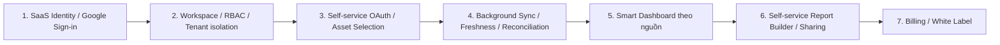

# VioAgencyAnalytics — SaaS Migration Roadmap

Ngày 23/10/2026, cập nhật customer-first sau rebrand. VIO Agency là đơn vị phát triển, sở hữu và vận hành. Đây là các task riêng sau rebrand; lượt này chỉ sửa năm tài liệu được chỉ định. Chưa triển khai code SaaS/migration/runtime cho đến khi người dùng thống nhất và chấp thuận kiến trúc. [Architecture](VIOAGENCYANALYTICS_ARCHITECTURE.md) là cơ sở ownership và isolation, [Product Vision](VIOAGENCYANALYTICS_PRODUCT_VISION.md) định nghĩa MVP.

## Trình tự và release gate

Rebrand → thiết kế identity/tenant → Customer Authentication → Organization/isolation + onboarding → self-service connections → sync/freshness → Smart Dashboards → customer Report Builder/publication → Billing/White Label. Có thể thiết kế UX trước nhưng không mở customer API trước gate tenant isolation. Pipeline Dataset/Bundle hiện có tiếp tục hoạt động trong mọi giai đoạn.

### MVP đầu tiên: Facebook Content VIO từ đầu đến cuối

Mục tiêu nghiệm thu: **Google Sign-in → Workspace → tạo/chọn Client/Brand → Connect Facebook Content VIO trên Web → khách consent → chọn Page → initial sync tự động → xem Dashboard thật**. Không đợi Report Builder mới được xem dữ liệu. VIO chỉ chuẩn bị provider app cấp hệ thống, không kết nối Page hay bấm Sync/duyệt báo cáo thay người dùng.

| Mốc phụ thuộc | Kết quả phải có trước mốc tiếp theo |
|---|---|
| 1. Identity | Customer identity/session riêng, Sign-in không cấp quyền Marketing hoặc role admin |
| 2. Workspace/RBAC | Create/join/switch, Client scope, hai Organization kiểm thử không truy cập chéo, mapping legacy và sandbox được tách rõ |
| 3. Facebook Content OAuth | Connect từ Web, callback backend, token mã hóa per connection, discover/chọn Page được phép; tài khoản sai/quyền thiếu/cancel có UX đúng |
| 4. Initial sync và refresh nền | Sau lưu Page tự enqueue đúng một công việc logic, reload/retry không nhân bản; worker ghi dữ liệu/receipt/quality và trả status/coverage; reconciliation xử lý dữ liệu đến muộn |
| 5. Live Dashboard | Hiển thị KPI Facebook Content thực có, null/missing rõ, timezone/as-of/coverage và date/comparison đúng; có dashboard dù chưa tạo/phát hành Bundle |

Tái sử dụng Meta adapters, Insights collector, worker, metric reader, Data Foundation và các thành phần biểu đồ/renderer. Những phần còn thiếu là context/authorization đa tenant, orchestration tự động sau asset selection, live read API và customer UX; không chỉ mở các API `admin` cho mọi user. Google SEO và Meta Ads mở sau mốc này với acceptance riêng; MVP không phụ thuộc vào việc hỗ trợ đồng thời mọi provider.

Sandbox VIO là nơi kiểm chứng code/metric bằng dữ liệu thật có cấp quyền, vẫn phải gắn nhãn sandbox. Không lấy token, thông tin cấu hình riêng hoặc dữ liệu sandbox để điền production, không đổi `client_meta_sandbox` thành production tenant. Production dùng Organization/connection/consent và sync mới được phép; dữ liệu sandbox chỉ phục vụ đối chiếu trong phạm vi test. Không gọi provider hoặc đọc dữ liệu sandbox trong task tài liệu hiện tại.

**Gate hoàn thành MVP:** toàn hành trình do customer thực hiện trên Web; không cần VIO thao tác thủ công; hai tenant vượt negative tests; không có credential lọt ra Web; OAuth replay/sai scope và job sai tenant bị chặn; sync lỗi/partial/stale không tạo số liệu giả; dashboard không phụ thuộc publication; mọi Published revision/grant cũ giữ hành vi được phép và hash snapshot. Live acceptance cho Page pilot và production readiness được báo riêng, không dùng bằng chứng sandbox thay nghiệm thu production.

Mỗi task phải kiểm tra lại working tree, phiên bản migration và bằng chứng hiện hành. Không dùng số PASS lịch sử làm acceptance mới. Tất cả migration phải có dry-run trên bản sao dùng riêng, counts/hash checks, phương án rollback và test tenant denial trước rollout. Không sửa sealed snapshot/report revision khi backfill metadata.

## 0. Rebranding — mốc trước lượt rà soát customer-first

- **Repository:** Admin và Web.
- **Dependency:** audit cả hai Git root, local changes, contract và deployment config.
- **Phạm vi:** branding UI/metadata, README, product/architecture/roadmap/UX và file map. Giữ namespace kỹ thuật KDH và dữ liệu khách hàng.
- **Migration:** không có; không đổi package Python, DB, OAuth, Docker hoặc Git remote.
- **Rủi ro:** thay chuỗi trúng client ID/contract; đè local changes; tên dài tràn sidebar; README hứa tính năng chưa có.
- **Acceptance:** tên sản phẩm đúng, ownership VIO rõ; kiểm thử offline liên quan PASS hoặc SKIP có lý do; không xóa/rename; mọi thay đổi ngoài branding nằm trong roadmap. Kết quả thực tế ở [REBRAND_FILE_MAP](REBRAND_FILE_MAP.md).

Lượt rà soát kế tiếp chỉ hiệu chỉnh Product Vision, Architecture, Roadmap, Rebrand File Map và Customer Workspace UX. Không sửa UI/code/config đã rebrand, không chạy lại nghiệm thu runtime. Release gate của lượt này là tài liệu nhất quán và người dùng chấp thuận kiến trúc trước implementation.

## 1. Customer Authentication / Google Sign-in

- **Repository:** Admin sở hữu identity, session và authorization; Web sở hữu landing/login/logout/error UX.
- **Dependency:** chốt mô hình user/membership, origin/session boundary, threat review và cấu hình identity riêng. Đọc tài liệu OIDC/GIS chính thức tại thời điểm triển khai, chọn thư viện tương thích đang dùng.
- **Phạm vi:** Google Sign-in, validation issuer/audience/expiry và các ràng buộc chống replay phù hợp flow; session/revocation, CSRF, redirect allowlist, xử lý hủy đăng nhập. Không nhận mật khẩu provider, không tự xin scope Marketing khi login.
- **Migration dự kiến:** external identities unique theo issuer+subject; chính sách account linking với user cũ và session/audit metadata nếu cần. Không auto-link chỉ dựa email, không nâng internal admin role. Giữ fallback vận hành nội bộ khi rollout.
- **Rủi ro:** nhầm identity consent với data consent; account takeover qua linking; redirect/session fixation; dùng session cũ vượt scope.
- **Acceptance:** login/logout, hết hạn/revoke/replay/wrong audience/issuer/redirect bị kiểm tra; không thấy provider data hoặc token sau Sign-in; user cũ vẫn dùng được luồng được phép; không public API customer trước khi task 2 hoàn tất.

## 2. Organization/Workspace, Multi-tenant và Customer Onboarding

- **Repository:** Admin quản lý Organization/membership/Client/Brand, authorization, tenant isolation; Web xây create/join/switch Workspace và settings.
- **Dependency:** mô hình task 1, inventory mọi truy vấn/job/cache/export/secret/grant; policy vai trò và support access; mapping legacy được chủ dữ liệu duyệt.
- **Phạm vi:** một Organization tương ứng một Workspace ở MVP; Agency quản lý nhiều Client/Brand; owner/admin/editor/reviewer/viewer theo policy. Invite có hạn, one-use, binding danh tính/phạm vi; thu hồi thành viên có hiệu lực trên phiên/job được phép. Onboarding tiếp tục được sau reload, không tự tạo nguồn/asset.
- **Migration dự kiến:** organizations, memberships, invitations, brands; ownership links/index/FK/uniqueness; backfill có quarantine; metadata ngoài JSON immutable. Tenant predicate bắt buộc; RLS là quyết định riêng sau đánh giá pooling/SQLite parity.
- **Rủi ro:** user thuộc nhiều org nhận nhầm role; client ID cũ bị hiểu thành tenant; grant, secret, cache hoặc background job đọc chéo; tự gộp sandbox với production.
- **Acceptance:** ít nhất hai Organization với user chung và riêng vượt bộ negative tests CRUD/list/search/export/job/cache/grant; forged IDs bị deny; invite replay/expiry/revoke bị deny; counts/hash legacy và mọi revision giữ nguyên; không khóa mất owner cuối; migration rollback rehearsal thành công. VIO Super Admin không tự bypass quyền dữ liệu.

## 3. Self-service Provider Connections

- **Repository:** Admin OAuth/token/discovery/selection và policy; Web giao diện kết nối/chọn nguồn/asset.
- **Dependency:** task 1–2, provider-specific acceptance matrix, app review/permissions cần thiết và token ownership schema. Login Google không đáp ứng dependency data consent.
- **Phạm vi:** khách connect/reconnect/disconnect từ Web bằng OAuth chính thức; provider/Organization/Client/Connection binding; chọn tài sản có quyền. Facebook Content VIO làm nguồn MVP đầu tiên; Google SEO và Meta Ads triển khai tiếp với nghiệm thu riêng. Google Ads/TikTok/YouTube chỉ mở sau có adapter, provenance và acceptance phù hợp. VIO Super Admin chỉ quản lý provider app cấp hệ thống.
- **Migration dự kiến:** connection/token ownership theo Organization, OAuth transaction binding, asset uniqueness theo phạm vi; token rotation/revocation metadata. Không chuyển secrets sang Web hoặc tự đổi existing scope.
- **Rủi ro:** callback nhầm Organization; quyền provider bị thu hồi; chọn asset cùng tên nhưng khác chủ; secret lộ qua API/log; tự bật nhiều nguồn sau Sign-in.
- **Acceptance:** user không có manage-connections bị deny; callback sai state/session/scope bị deny; asset chọn rõ ràng, không auto-select; scopes/account/expiry được kiểm tra; reconnect kiểm tra asset lại, revoke/rotation không dùng nhầm credential; disconnect ngăn sync mới nhưng không sửa published revisions; browser/Web không nhận token; test fixture và provider acceptance có cấp phép được báo riêng. Không đạt live acceptance thì UI ghi chưa khả dụng.

## 4. Background Sync / Freshness / Reconciliation

- **Repository:** Admin worker/scheduler/storage/quality; Web sync progress, retry có quyền, freshness/error UX.
- **Dependency:** task 2–3, idempotency và metric semantics, quota/concurrency budget, lịch và timezone per asset.
- **Phạm vi:** tự enqueue initial sync khi khách chọn asset, bảo đảm phục hồi nếu lưu selection xong nhưng enqueue gián đoạn; kế thừa worker, mở rộng durable job lease, retry/backoff/cancel, scheduling, incremental/backfill/watermark, status/coverage và reconciliation dữ liệu đến muộn; chặn duplicate và starve tenant khác; freshness được tính từ dữ liệu thật.
- **Migration dự kiến:** tenant-bound job/schedule/lease/idempotency fields, indexes; nguồn snapshot/receipt và freshness metadata cần thiết. Bảo toàn snapshot bất biến, không sửa worker hàng loạt khi chưa có regression baseline.
- **Rủi ro:** retry nhân bản dữ liệu, late-arriving data, lệch timezone, API quota, revoked token, sync treo hoặc tự vượt quyền sau membership change.
- **Acceptance:** offline fixture cho retry/interruption/recovery/idempotency và isolation PASS; UI phân biệt empty/partial/failed/stale; missing/null không thành zero; daily và period totals đối soát đúng từng provider; GET dashboard/report không gọi provider; live acceptance chỉ thực hiện trong task được cấp quyền riêng.

## 5. Smart Dashboards

- **Repository:** Admin read model/KPI/quality và scoped API; Web dashboard/filter/comparison/chart/empty/error.
- **Dependency:** task 2–4, semantic/versioned KPI contract, completeness/coverage policy, Client/Brand/timezone/currency mapping.
- **Phạm vi:** dashboard tự hiển thị theo nguồn đã kết nối và có dữ liệu hợp lệ, khách tùy chỉnh cấu hình/filter ngày/so sánh, giải thích freshness/coverage, insight dựa bằng chứng. Quality gate tự động; không yêu cầu review/publication thủ công để xem live. Không coi dashboard mẫu đang có là dữ liệu customer live.
- **Migration dự kiến:** dashboard configuration, read model/cache keys hoặc aggregate tables nếu cần; versioned metric definitions, tenant-aware index. Chốt schema trong thiết kế riêng; không bắt buộc thêm bảng khi reader hiện có đáp ứng.
- **Rủi ro:** cộng unique users/reach sai, gộp currency, lấy mẫu điền thiếu, lộ cache khác tenant, nhầm live với published.
- **Acceptance:** hai chế độ có nhãn rõ, đúng as-of và coverage; không hiển thị fake zero; date/comparison có kiểm tra; stale/revoked/partial hiển thị đúng; tenant-negative tests và KPI fixture PASS; browser responsive/a11y qua viewport; published revision không đổi sau sync/filter.

## 6. Self-service Report Builder / Templates / Publication / Sharing

- **Repository:** Admin templates/draft/Dataset/review/approval/release/Bundle/grant; Web builder/preview/reports/sharing UX. Không chuyển business logic sang Web.
- **Dependency:** task 2–5 cho trải nghiệm customer; kế thừa pipeline publication hiện có ngay từ đầu; policy reviewer/publisher và quyền chia sẻ rõ ràng.
- **Phạm vi:** customer thao tác trên Web: template có version, chọn Dataset bất biến, section config, preview, review gắn hash, phát hành provisional/final theo policy Workspace, revisions và export/cấp/thu hồi quyền chia sẻ cho Client Viewer. Không yêu cầu nhân viên VIO làm reviewer/publisher. Scheduled delivery là subtask sau, chỉ gửi revision được duyệt và có quyền.
- **Migration dự kiến:** tenant-owned templates/config versions, report ownership metadata và delivery schedules/audit nếu triển khai; không rewrite Bundle JSON cũ, không sửa report IDs/revisions/seals. Endpoint mới có version, giữ internal contract cũ đến khi client được migrate đồng bộ.
- **Rủi ro:** sửa nhầm published revision; stale approval; report nhiều Client không cùng scope; share link vượt revision/grant; schedule publish khi nguồn lỗi.
- **Acceptance:** draft không xuất hiện trong customer published routes; approval sai hash bị chặn; version mới không sửa version cũ; revoked/no-grant/wrong revision bị deny; người nhận và schedule không vượt quyền; render fixture của các Bundle cũ PASS cùng luồng mới.

## 7. SaaS Billing và White Label

- **Repository:** Admin subscription/entitlement/billing events/domain policy/audit; Web billing/settings/brand UI; VIO Super Admin vận hành thuê bao.
- **Dependency:** task 1–6 và isolation nghiệm thu; chọn payment provider, chính sách thuê bao/hạn mức, lưu trữ và custom domain trong task thiết kế riêng.
- **Phạm vi:** plan/subscription, entitlement, xử lý webhook idempotent, billing portal; branding per Organization, domain verification và preview. Không thay ownership VIO trong tài liệu nội bộ hoặc giả mạo quyền sở hữu nguồn.
- **Migration dự kiến:** subscriptions, billing customers/events, entitlements/usage counters, branding/domain records và audit. Giữ lịch sử publication; xác định riêng chính sách branding của revision mới và cũ.
- **Rủi ro:** duplicate/out-of-order webhook, billing bật quyền dữ liệu, domain/cookie crossover, brand asset không an toàn, hạn mức xóa dữ liệu hoặc khóa rollback.
- **Acceptance:** sandbox payment/webhook signature/replay/reconciliation PASS; billing không cấp cross-tenant data access; hạn mức có hành vi rõ ràng không phá dữ liệu; domain isolation và asset validation PASS; legacy Bundle giữ nguyên; white label không yêu cầu đổi technical namespace tùy ý.

## Task kỹ thuật độc lập: tên Docker, namespace và đường dẫn cũ

Sau roadmap thiết kế, nếu thực sự cần đổi `kdh/`, remote, Compose/network/volume hoặc launcher/path cũ, phải mở task riêng với dependency map cả hai repo, consumer inventory, backup/restore/rollback và kiểm thử đồng bộ. Không cần đổi tên kỹ thuật để đạt rebrand hiển thị. `run.py`, các script ops và evidence Phase 9 giữ nguyên trong lượt này. Xem các hàng DEFER trong file map.

## Điều kiện cần thống nhất trước implementation

- Người dùng chấp thuận kiến trúc customer-first, phạm vi MVP và các task triển khai tiếp theo.
- Chốt role/capability, reviewer/publisher policy, hỗ trợ có thời hạn; không tự map role `admin` cũ sang customer hoặc cấp VIO quyền đọc tenant.
- Chốt Organization = Workspace 1:1, Client/Brand tối thiểu, asset ownership và mapping legacy; rehearsal migration giữ hash revision và không gộp sandbox/production.
- Chọn Google identity/session/origin boundary; xác nhận provider app/permissions và Page pilot đủ điều kiện. Các yêu cầu provider cụ thể phải được kiểm tra theo tài liệu chính thức khi triển khai, không suy từ sandbox đang hoạt động.
- Chốt token lifecycle/key rotation/retention; lịch sync, quota, backfill, reconciliation, timezone, KPI nào đủ bằng chứng và cách hiển thị partial/stale.
- Chốt contract live read riêng với Published Report, regression/isolation acceptance và cách rollout từng bước có rollback. Chưa thêm routes, migrations hay API trong lượt tài liệu này.
