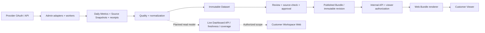
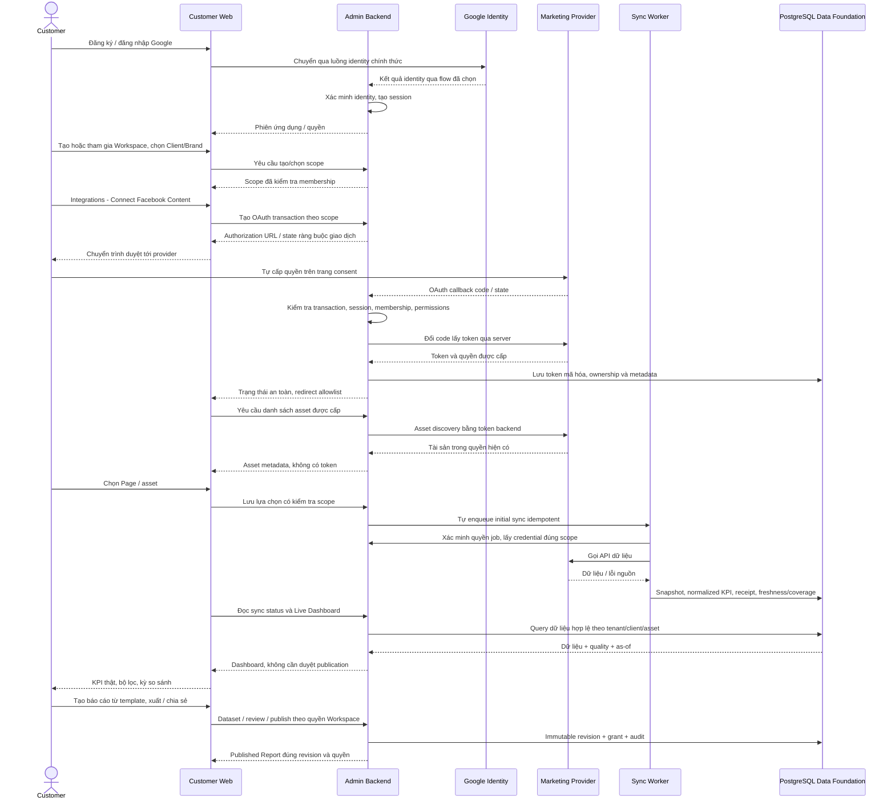
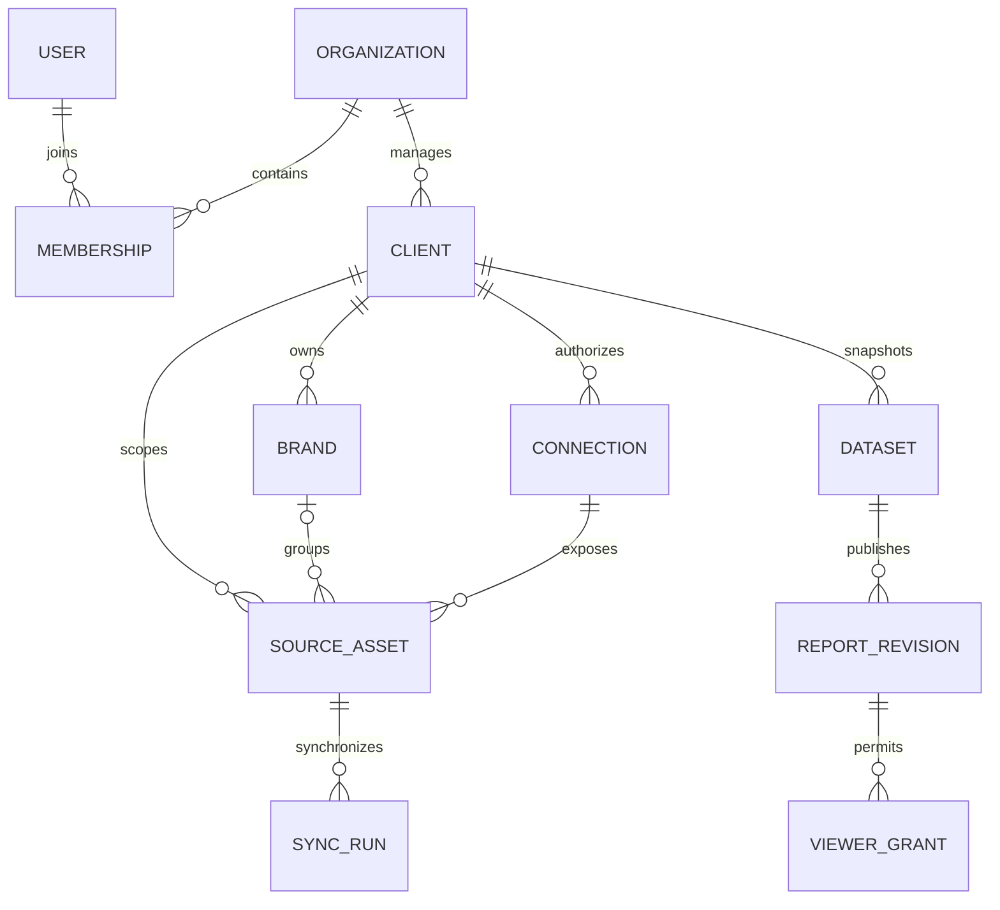
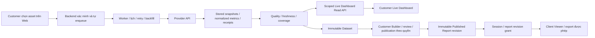

# VioAgencyAnalytics — Architecture

Ngày 23/10/2026, bổ sung rà soát **customer-first / self-service** sau rebrand. VIO Agency phát triển, sở hữu và vận hành sản phẩm. Tài liệu này tách **source hiện có**, **bằng chứng lịch sử**, và **thiết kế dự kiến**. Lượt này chỉ sửa tài liệu; triển khai SaaS cần người dùng thống nhất và chấp thuận kiến trúc trước.

## 1. Cơ sở audit và trạng thái hiện tại

Đã đối chiếu hai working tree (không chỉ HEAD), `AGENTS.md`, `SYSTEM_CONTEXT.md`, `KDH_ARCHITECTURE.md`, `DATABASE_ARCHITECTURE.md`, audit UX 19/10, Phase 9 và các ghi nhận 21–22/10. README cũ nói Meta chỉ có OAuth và Dataset-from-sync còn thiếu đã lỗi thời so với implementation. `KDH_PROVIDER_STATUS.md` là mốc 10/10, không dùng như trạng thái Meta hiện tại. Không truy cập Docker, database hoặc provider trong lượt này.

| Khả năng | Bằng chứng source hiện tại | Mức chứng minh / giới hạn |
|---|---|---|
| Identity nội bộ | `kdh/app.py`, `kdh/core.py`; user/session/CSRF, admin/operator/viewer | Tài khoản nội bộ, không phải customer Google Sign-in hay Organization RBAC. |
| Google SEO | `kdh/google.py`, `kdh/jobs.py`, `kdh/seo_composite*.py` | Có OAuth/adapters GA4, GSC, Sheets Keywords, sync và Dataset; không kiểm chứng lại tài khoản thật trong lượt này. |
| Meta Facebook Content/Ads | `kdh/meta.py`, `meta_reporting.py`, `meta_reporting_worker.py`, `meta_reporting_routes.py`, `meta_marketing.py` | Có OAuth, discovery/select asset, collector, worker, receipt và release path; code tồn tại không chứng minh mọi tài khoản/KPI được chấp nhận. |
| Facebook Content Insights | `kdh/meta_content_insights.py`, `facebook_content_report.py` là file local untracked có trước task; các caller có thay đổi local | Collector Page/Post và projection hiện có; evidence 22/10 ghi nhận dữ liệu VIO, nhưng thiếu metric/coverage/time boundary vẫn phải giữ null/status. Không sửa các file này. |
| Dữ liệu/review/publication | `kdh/platform_data.py`, `platform_dataset.py`, `marketing_dataset.py`, `marketing_review.py`, `marketing_source_check.py`, `marketing_approval.py`, `marketing_publication.py`, `report_bundles.py` | Pipeline lưu dữ liệu → Dataset → review/release → Bundle đã có; Builder cũ còn ràng buộc client và không bắt buộc cho luồng Marketing. |
| Viewer/handoff | `kdh/viewer_access.py`, `viewer_handoff.py`; Web `app/routes/viewer.py`, `handoff.py`, repositories/mappers | Kiểm tra session/client/report/revision/grant; sandbox có điều kiện rõ ràng, không phải tenant runtime. |
| Web dashboard | `main.py`, `app/routes/pages.py`, `app/mappers/dashboard.py`, `templates/pages/` | Production hiển thị Bundle đã phát hành; mock/design preview và internal preview là các luồng riêng. |
| GMB/GBP | `kdh/reports.py`, CSV và luồng phân tích hiện có | Import CSV không đồng nghĩa OAuth API trực tiếp đã được nghiệm thu. |
| TikTok Ads | `kdh/platform_registry.py`, `docs/TIKTOK_ADS_SCAFFOLD.md` | `planned`, không có OAuth/worker/provenance production; dashboard Web là mẫu. |
| YouTube, Google Ads, Instagram, TikTok organic, CRM | Metric Catalog, các mock/thiết kế hoặc script chẩn đoán rời | Không đủ bằng chứng pipeline production được nghiệm thu. Script thử API không phải integration runtime. |

Phase 9 chứng minh tại thời điểm 19/10 một Published Bundle VIO provisional revision 1 mở được qua handoff trên sandbox. Các ghi nhận trong `SYSTEM_CONTEXT.md` ngày 21–22/10 mô tả shared Viewer 8080 và Insights; không biến số PASS cũ thành kết quả kiểm thử ngày 23/10. Tài liệu audit cũ từng ghi “chưa có Bundle” là trạng thái trước Phase 9, không phải kết luận hiện tại.

### Current State vs Target State

Tài liệu sau rebrand đã đề cập self-service, identity riêng và tenant isolation. Khoảng cách chính nằm ở runtime còn Admin-first và sơ đồ cũ thiên về đường phát hành; không thể coi đổi tên UI hoặc đổi điểm vào là đã đạt SaaS.

| Điểm đối chiếu code local | Current State | Target State — chưa triển khai |
|---|---|---|
| Web `app/routes/viewer.py:admin_selection`, `main.py:production_reports_only` | `/`, `/login`, `/reports` chuyển về Admin; production giới hạn ở Viewer/Bundle và internal preview có quyền | Khách bắt đầu trên Web: Google Sign-in, Workspace, Client/Brand, Integrations, dashboard, reports |
| Admin `kdh/app.py:google_connect/meta_connect`, callbacks | Connect/callback yêu cầu `admin`, redirect về `/#connections...`; Google callback còn enqueue theo cấu hình hiện có | Customer có capability trong Workspace khởi tạo từ Web; callback backend ràng buộc tenant/connection và quay về Web |
| `kdh/meta_reporting_routes.py:reporting_select_asset/reporting_sync` | Asset selection và sync là hai thao tác API Admin riêng; chọn asset chưa tự enqueue initial sync | Khách chọn asset trên Web; backend xác nhận rồi tự enqueue initial sync idempotent |
| `kdh/meta.py:Meta.__init__`, `meta_reporting_worker.py:_prepare` | Meta instance dùng client cấu hình sẵn, chỉ primary/sandbox; secret theo client; worker kiểm tra actor role `admin` | Connection/token/job theo Organization/Client/Connection; kiểm tra capability customer và scope lúc thực thi |
| `kdh/meta_reporting_routes.py:reporting_meta_kpis`, Web `app/mappers/dashboard.py` | Có reader KPI nội bộ; màn hình customer production dựng từ Bundle. Tên `content_live` không chứng minh có customer Live Dashboard API | Live read API có tenant/asset scope đọc dữ liệu đồng bộ, độc lập publication; giữ renderer cho Published Report |
| `kdh/marketing_publication.py`, `report_bundles.py`, `viewer_access.py` | Release approval, snapshot/hash, revision và Viewer grant đã có, gắn quyền nội bộ/client | Kế thừa invariants; bổ sung ownership và policy customer, không yêu cầu VIO duyệt thay khách |

Đây là kết luận từ source working tree, không phải kiểm tra provider, database hoặc container đang chạy. Các chốt Admin/sandbox hiện có giữ nguyên cho tới task triển khai được phép; không tháo guard để giả lập self-service.

## 2. Trách nhiệm hai repository

| Thành phần | Trách nhiệm |
|---|---|
| Admin Backend — Flask | Business logic, identity/authorization, Organization/tenant, provider OAuth và token, ingestion/scheduling, KPI, quality, Dataset, review/approval/publication, internal API. Các mục SaaS là mở rộng dự kiến. |
| Customer Web — FastAPI/Jinja2/Vanilla JS | Đăng nhập/onboarding, Workspace, giao diện kết nối và chọn asset, dashboard, builder/templates, reports và quản lý thành viên theo quyền; hiện chủ yếu là Viewer. |
| VIO Super Admin | Giao diện vận hành: System Overview; Organization/Tenant; Provider App Configuration; API, Job/Worker và Data Quality Monitoring; Dashboard/Report Template Management; Security/Audit và hỗ trợ kỹ thuật; Subscription Management sau. |

Web backend có thể điều phối request/hiển thị nhưng Admin quyết định quyền và dữ liệu. Web không truy cập database Admin trực tiếp, không gọi provider API, không nhận access/refresh token provider. Service credential giữa hai backend không thay thế danh tính và quyền customer.

**Mọi kết nối customer bắt đầu từ Web.** VIO Super Admin chỉ cấu hình ứng dụng tích hợp cấp hệ thống, ví dụ Meta App hoặc Google OAuth Client; khách tự OAuth cho Page/Ad Account/Property của mình. VIO không phải người kết nối tài khoản hay tạo báo cáo thay khách. Quyền vận hành không mặc định cho phép đọc dữ liệu nhạy cảm của tenant; hỗ trợ có quyền tạm thời, mục đích, hạn dùng, thu hồi và audit theo policy được duyệt.

**Luồng dữ liệu hiện có** (không phải toàn bộ hành trình SaaS):

### Hành trình customer-first mục tiêu

Khách đăng ký/đăng nhập bằng Google → tạo/tham gia Workspace → tạo/chọn Client/Brand → Data Sources / Integrations → Connect nguồn được hỗ trợ → consent chính thức → chọn tài sản được phép → tự đồng bộ → dashboard thật → tùy chỉnh bộ lọc/kỳ so sánh → tạo/xuất/chia sẻ báo cáo theo quyền. Meta Ads, Facebook Content, GA4, GSC hoặc nguồn khác chỉ hiện Connect khi integration đã đủ điều kiện. Không nhập mật khẩu Marketing vào sản phẩm. Gửi báo cáo theo lịch là bước sau.

Sơ đồ thể hiện trách nhiệm và hướng request/response, không chốt giao thức identity hay đường endpoint mới. Redirect trình duyệt tới Google/provider là bước xác thực/consent chính thức; Web không tự đổi token hoặc ingestion. Customer không phải mở giao diện VIO Super Admin ở bất kỳ bước nào.

## 3. Identity và quyền mục tiêu — chưa triển khai

Google Sign-in dùng cơ chế phù hợp như OIDC/Google Identity Services để xác thực người dùng. Admin kiểm chứng danh tính và phát hành session; chọn giao thức/SDK cụ thể trong task Authentication, dựa trên tài liệu chính thức tại thời điểm triển khai. Không tái sử dụng callback provider hiện tại làm callback đăng nhập chỉ vì cùng Google. Không tự liên kết tài khoản cũ dựa duy nhất vào email; cần chính sách liên kết có xác thực và không nâng quyền admin.

Provider OAuth là flow riêng: thành viên có quyền kết nối chọn Organization/Client trước, consent tại provider, Admin xác minh state/ràng buộc session/phạm vi và lưu token mã hóa. Web chỉ nhận trạng thái và danh sách asset đã được phép. OAuth thành công chưa đủ: cần chọn asset, kiểm tra scope/quyền, đồng bộ và quality. Không nhập mật khẩu provider vào sản phẩm.

Authentication trả lời “ai đang dùng ứng dụng”; membership/RBAC trả lời “được làm gì trong Workspace”; provider consent trả lời “connection được truy cập tài sản Marketing nào”. Ba kiểm tra này độc lập và đều cần thiết. Không map role nội bộ `admin` thành customer Owner hoặc VIO Super Admin tự động.

MVP định nghĩa Organization = tenant và Workspace là tên UI của Organization. Một Agency Organization có nhiều Client; Client có nhiều Brand. Một user có nhiều membership, mỗi membership có vai trò riêng. Việc biết tenant ID/client ID không cấp quyền.

| Vai trò mục tiêu | Phạm vi được đề xuất |
|---|---|
| VIO Super Admin | Quản trị nền tảng; hỗ trợ truy cập dữ liệu khách hàng phải qua cấp quyền tạm thời và audit, không mặc định bypass tenant. |
| Organization Owner | Quản trị Organization, chuyển owner, thành viên; billing ở giai đoạn sau. Không tự thành VIO Super Admin. |
| Organization Admin | Quản lý Client/Brand, thành viên và kết nối trong Organization theo policy. |
| Analyst/Editor | Đọc dữ liệu, tạo Dataset/bản nháp trong Client được cấp. Không mặc định quản lý token hay phát hành. |
| Reviewer/Publisher | Quyền review/approve/publish được cấp riêng, gắn snapshot/hash; policy phân tách người tạo/người duyệt phải được quyết định trước rollout. |
| Customer Viewer | Chỉ đọc dashboard và/hoặc revision được cấp; không thấy secret hoặc quyền quản trị. |

Ba vai trò runtime `admin/operator/viewer` hiện có giữ nguyên. Bảng trên không phải mapping tự động và không mở rộng quyền Viewer hiện hành.

Permission boundary mục tiêu: API đọc live cần quyền đọc Client/asset; quản lý connection cần capability riêng; tạo draft/export cần quyền tương ứng; review/publish/share không suy ra từ quyền Connect. Mỗi request backend xác minh membership và chuỗi ownership, không tin `organization_id`/`client_id` do browser gửi. Worker kiểm tra lại trạng thái tenant, connection, asset và policy actor/service principal lúc chạy; lịch tự động có principal tenant-scoped, không mượn quyền VIO Super Admin. Thu hồi quyền không được né bằng cache, export, job retry hoặc service credential. Reviewer/Publisher thuộc Workspace; không bắt buộc nhân viên VIO tham gia quy trình của khách.

### Token lifecycle mục tiêu

| Giai đoạn | Xử lý bắt buộc ở backend |
|---|---|
| Tạo giao dịch | Ràng buộc state một lần, thời hạn, session/actor, Organization/Client/Connection đích, provider và return URL allowlist; áp dụng ràng buộc giao thức như PKCE khi flow yêu cầu/hỗ trợ |
| Callback/consent | Kiểm tra lại giao dịch và quyền, chống replay/cross-tenant; đổi code server-side, xác minh account/scopes và thời hạn được provider trả về; lỗi hoặc cancel không tạo trạng thái connected giả |
| Lưu trữ | Token mã hóa với key chỉ backend quản lý; ownership theo Organization/Client/Connection, metadata scopes/expiry/consent/version; giữ audit không có token. Provider app secret là cấu hình cấp hệ thống, tách token của khách |
| Sử dụng | Chỉ connector/worker được giải mã credential đúng scope khi cần; không đưa user/Page/refresh token vào Web, URL trả về, log, Dataset, Bundle hoặc export |
| Gia hạn/rotation | Theo khả năng từng provider; không giả định Meta có refresh token như Google. Dùng expiry/data-access expiry thực có; serialize rotation theo connection, tránh job ghi đè token mới; thiếu quyền/gia hạn thất bại chuyển needs_reauth |
| Reconnect | Khách khởi tạo lại từ Web; kiểm tra account/scope và quyền asset lại, version credential và vô hiệu giao dịch cũ; không tự bật lại mọi asset hoặc dùng token tenant khác |
| Disconnect/revoke | Ngăn job/lịch mới, vô hiệu credential local, revoke tại provider khi hỗ trợ và báo trung thực kết quả; job đang chạy phải tái kiểm tra trước khi ghi dữ liệu. Thu hồi consent không sửa Published Report cũ; truy cập dữ liệu lưu theo membership/grant và retention policy |

Hiện đã có mã hóa, state/callback và disconnect trong adapter; vòng đời đa tenant, token per connection, key rotation và xử lý cạnh tranh cần thiết kế/kiểm thử riêng. Khi xóa tenant hoặc yêu cầu xóa dữ liệu, phải thống nhất retention và chính sách truy cập/thu hồi report trước triển khai; không sửa bytes của revision để xử lý việc thu hồi quyền.

## 4. Tenant isolation và database dự kiến

Các bảng `clients`, `connections`, `source_assets`, `sync_runs`, `daily_metrics`, `source_snapshots`, review/release, Bundle/grant đã có; nhiều entity đã mang `client_id`. `users`, Dataset và secret có đường dùng legacy cần audit ownership trước khi thêm tenant. Không giả định `client_id` hiện tại đã bảo vệ mọi truy vấn.

**Quan hệ mục tiêu:** Tenant là ranh giới cách ly của Organization; Workspace là tên trải nghiệm 1:1, không phải một tenant khác. Organization có nhiều Client; Client là phạm vi dữ liệu/báo cáo, có thể đại diện một Brand ở MVP. Nếu cần nhiều Brand trong một Client, phải bổ sung mapping asset → Brand rõ ràng trước khi bật tính năng. Connection thuộc đúng một Organization và một Client trong MVP; tài sản được discover chưa mặc nhiên được chọn cho sync. Source Asset liên kết connection, Client và Brand đích nếu có; tất cả cùng Organization. Provider external ID không phải global ownership key: cùng một Page có thể được cấp quyền hợp lệ cho nhiều Organization, nhưng token, mapping, job, cache và dữ liệu của mỗi tenant phải độc lập. Không tự gộp asset theo tên hoặc external ID. Chia sẻ một connection giữa nhiều Client để sau một quyết định riêng.

Đề xuất migration riêng, **không thực hiện trong task này**:

1. Thêm `organizations`, `organization_memberships`, `organization_invitations`, bảng external identity (issuer/subject), và `brands` nếu MVP cần. Workspace không thêm bảng độc lập khi vẫn 1:1.
2. Lập bảng mapping được duyệt cho dữ liệu legacy → Organization. Không suy ra Organization từ tên KinderHealth/VIO; giữ nguyên client ID, report ID, revision, grant và snapshot bytes/hash.
3. Mở rộng metadata ownership ở Client và các bảng phụ thuộc; composite foreign keys/unique indexes ngăn asset/connection/report tham chiếu khác Organization. Với payload bất biến, dùng metadata/bảng liên kết bên ngoài thay vì sửa JSON đã seal.
4. Backfill theo batch có kiểm chứng counts/hash và quarantine bản ghi chưa xác định owner. Không kích hoạt truy cập customer trước khi hoàn tất ownership và truy vấn có scope.
5. Áp dụng repository/service authorization fail-closed, ràng buộc tenant vào job, watermark, cache key, export/object path, OAuth state và grant. RLS PostgreSQL là lớp bổ sung cần quyết định, kiểm thử connection pooling và so sánh đường SQLite test trước khi chọn; không dùng RLS thay kiểm tra ứng dụng.
6. Giai đoạn expand → verify → enforce constraints → rollout có feature flag. Restore/rollback phải rehearsal trên bản sao dùng riêng, giữ sealed revision; không rollback schema phá hủy khi đã có tenant data mới.

Migration phải nối tiếp số migration thực tế (`kdh/migrations.py` hiện có 1–8), không sửa migration cũ hoặc tự gán số tương lai khi còn thay đổi song song. Phải kiểm thử truy cập chéo cho ID hợp lệ/sai, membership bị thu hồi, forged scope, job retry, cache/export, invitation replay và truy cập support.

Sơ đồ là quan hệ ownership khái niệm dự kiến, không phải DDL hoặc toàn bộ schema hiện hành; một revision có thể kết hợp nhiều Dataset và grants hiện có cho phép khoảng revision.

## 5. Đồng bộ và chất lượng dữ liệu

Kế thừa worker hiện có; không chuyển orchestration sang Web. Mở rộng dần job ownership, lease/idempotency, retry/backoff, rate-limit, concurrency và scheduling per Organization/provider. Asset phải được người có quyền chọn; không dùng Google Sign-in để tự khám phá mọi dữ liệu.

Sau khi xác minh và lưu lựa chọn asset, backend tự khởi tạo initial sync với khoảng ngày mặc định công khai và giới hạn provider. Cần bảo đảm lựa chọn đã lưu cuối cùng sẽ được enqueue dù request/process bị gián đoạn, đồng thời retry không tạo sync trùng; cơ chế transaction/outbox hoặc recovery tương đương được chốt khi triển khai. Không đợi nhân viên VIO bấm Sync. Sau initial sync, scheduler xử lý incremental sync, historical backfill có giới hạn và reconciliation cho dữ liệu đến muộn/thay đổi. Concurrency/quota chia theo tenant/provider; lỗi một nguồn không làm nguồn khác hiển thị dữ liệu giả.

Luồng tự động: job có scope → kiểm tra consent/quyền asset → gọi API provider → validate payload → lưu raw/source snapshot và normalized metrics/receipt → tính freshness/coverage/quality → cập nhật read model. Tái sử dụng transaction persistence và receipt Meta đang có; mở rộng job ownership/recovery thay vì viết lại collector. Reconciliation chỉ sửa read model hoặc tạo snapshot mới; không rewrite immutable Dataset/Published Report. Data freshness không phải chỉ là job succeeded: phải có fetched time, ngày dữ liệu mới nhất và khoảng thiếu.

Mỗi nguồn cần trạng thái riêng: chưa cấu hình, chưa cấp quyền, chưa chọn asset, queued/running, empty/partial/failed/succeeded, stale/revoked. Lưu và trả freshness/coverage với requested range, fetched time, latest available date, timezone, missing dates và cảnh báo. Giữ null khác zero; không cộng lifetime metrics thành period totals, không cộng unique users/reach theo ngày, không bình quân tỷ lệ tùy ý hoặc gộp tiền tệ.

API “refresh” dự kiến chỉ xếp job có authorization/idempotency; GET dashboard/preview/Bundle không gọi provider. Sync mới không thay snapshot đã được duyệt hoặc revision đã phát hành.

## 6. Hai chế độ hiển thị

| | Live Dashboard — mục tiêu | Published Report — hiện có, kế thừa |
|---|---|---|
| Dữ liệu | Read model mới nhất đã lưu, đạt quality phù hợp | Dataset/release snapshot đóng băng trong Bundle revision |
| Thay đổi | Có thể đổi sau sync; luôn có fetched time/as-of/coverage | Không đổi vì sync, filter hay branding trong DB |
| Quyền | Membership + Client/asset scope | Quyền report/revision, session/grant còn hiệu lực |
| Bộ lọc | Khoảng ngày trong coverage, so sánh có dữ liệu | Chỉ lọc trình bày trong snapshot; không tạo dữ liệu ngoài kỳ |
| Review | Không yêu cầu duyệt/phát hành thủ công; quality gate tự động, chỉ KPI có cơ sở dữ liệu hợp lệ | Review/source-check/approval/publication theo policy Workspace |

Report Builder customer dự kiến sử dụng template version + immutable Dataset IDs + configuration version. Tạo Dataset mới để cập nhật dữ liệu; review gắn hash; draft/preview không thể được chia sẻ như Published Report. Đường phát hành phải giữ source-check, release approval và grant; scheduled delivery chỉ gửi revision đủ quyền, không vượt review khi nguồn thiếu.

Quyền Live Dashboard và Published Report độc lập: grant một revision không mở quyền dữ liệu live, và đọc live không tự cấp quyền publish/share. Dashboard lọc theo source asset/period/quality, không đọc candidate nội bộ để né publication. Khi consent bị thu hồi, dashboard chỉ có thể hiển thị phần đã lưu còn được policy cho phép với nhãn stale/reconnect; report cũ vẫn giữ snapshot và kiểm tra grant trên mỗi lần đọc/xuất. Không fallback sang revision mới nhất nếu revision được yêu cầu không có quyền.

## 7. API dự kiến và tương thích

Các nhóm contract **đề xuất, chưa có route SaaS mới**: identity/session; Organization/membership/invitation; Client/Brand; authorized connections/assets; sync request/status; dashboard query/quality; templates/drafts/review/publication; report sharing. Cần thiết kế schema/version, pagination, validation, idempotency, audit, CSRF và error redaction trước implementation. Không ghi các tên endpoint giả như API đang hoạt động.

Web → Backend gửi hành động và phạm vi người dùng lựa chọn; backend tự xác minh session/capability/ownership rồi gọi service/worker. Backend → Web chỉ trả DTO an toàn: metadata connection/asset, job status, dữ liệu KPI kèm quality và Published Bundle đúng revision. Mọi poll/status/filter/export đều kiểm tra scope. Callback và token exchange kết thúc ở backend; UI nhận kết quả qua redirect allowlist và đọc trạng thái. Web có thể dùng lớp backend hiện có để gọi API VioAgencyAnalytics, không dùng service credential như quyền đọc toàn bộ tenant.

Giữ route `/api/google/callback`, `/api/meta/callback`, handoff, internal Bundle/Viewer API, response keys và `X-KDH-*`. Giữ Python package `kdh`, `run.py`, cookie namespaces, tên DB/schema, Compose/project/network/image/volume/mount. `compose.yaml` Web hiện include `compose.shared.yaml`, không phải một-backend service `app` trong README cũ. Host-origin routing hiện tại là biện pháp cấu hình local, không tái sử dụng làm tenant selector production.

Xem [file map](REBRAND_FILE_MAP.md) để biết phụ thuộc phải migration đồng bộ. Các tài liệu contract/handover `KDH_*.md` giữ tên và nội dung lịch sử; tài liệu này bổ sung hướng SaaS thay vì chép lại contract.

## 8. Kế thừa implementation và điều kiện triển khai

| Nền tảng giữ lại | Mở rộng cần có, không xây lại toàn bộ |
|---|---|
| Flask và services hiện có; Web FastAPI/Jinja2/Vanilla JS | Thêm identity/tenant services và customer UX; giữ kiến trúc hiện có, không đổi framework |
| `meta.py`, `meta_reporting.py`, `meta_content_insights.py`; Google adapters | Tái sử dụng OAuth/collectors/discovery; bỏ phụ thuộc client cấu hình ở lớp service bằng context đã authorize, thêm token per connection trong task riêng; không chỉ bỏ decorator admin |
| `jobs.py`, `meta_reporting_worker.py`, `platform_data.py`, metric reader/catalog | Kế thừa queue, transactional storage, receipts và KPI semantics; bổ sung tenant-scoped scheduling/retry/reconciliation và Live Dashboard API |
| Dataset, review/source-check/approval, `marketing_publication.py`, `report_bundles.py` | Giữ snapshot/hash/revision bất biến; chuyển authorization sang capability Workspace có regression tests, giữ policy quality |
| Viewer grant/handoff, Web repositories/mappers/templates/charts | Giữ Published Report compatibility; thêm session/onboarding và live read contract riêng, không biến Bundle renderer thành ingestion |

Web cần xây mới các luồng customer: Google Sign-in; create/join/switch Workspace; Client/Brand và user management; Data Sources/Connect/Reconnect/Disconnect; asset selection; sync status; cấu hình Live Dashboard/filter/comparison; template picker/Builder/preview/publication và export/sharing. Có thể tái sử dụng layout/chart/renderer nhưng mock dashboard không được dùng làm dữ liệu live.

Trước task implementation, người dùng cần chấp thuận kiến trúc và các quyết định: role/capability và reviewer policy trong Workspace; một hay nhiều Brand/Client ở MVP; mapping dữ liệu legacy; origin/session và Google identity flow; phạm vi provider app/permissions đủ cho Page pilot và rollout customer; token retention/key rotation/support access; khoảng initial backfill, timezone và KPI acceptance. Đây là điều kiện thiết kế/acceptance, không phải cấu hình đã được kiểm tra trong lượt này.

MVP đầu tiên theo [Roadmap](SAAS_MIGRATION_ROADMAP.md): Google Sign-in → Workspace → Client/Brand → Connect Facebook Content VIO → chọn Page → tự sync → dashboard thật. Dữ liệu sandbox có thể dùng đối chiếu trong sandbox với provenance rõ ràng; không nâng `client_meta_sandbox`, consent/token hoặc số liệu của nó thành production. Chỉ coi MVP đạt khi hai Organization cách ly và dashboard hiển thị dữ liệu đã sync đúng phạm vi mà không cần VIO thao tác/duyệt report.
